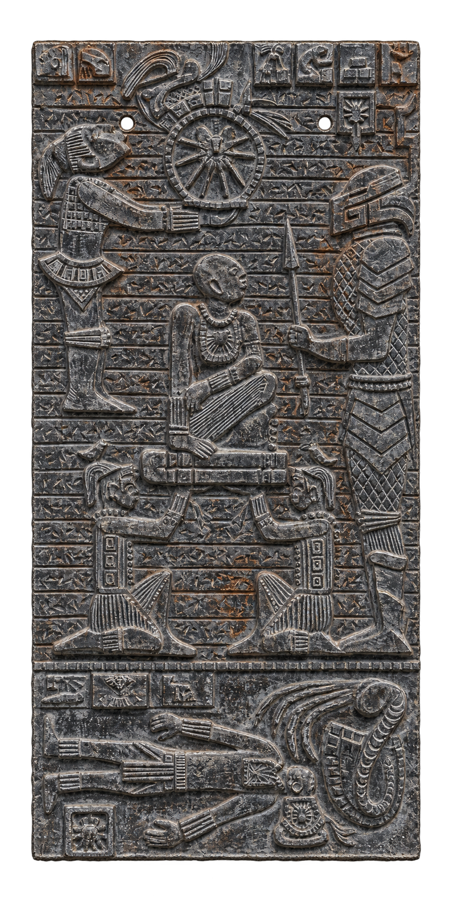
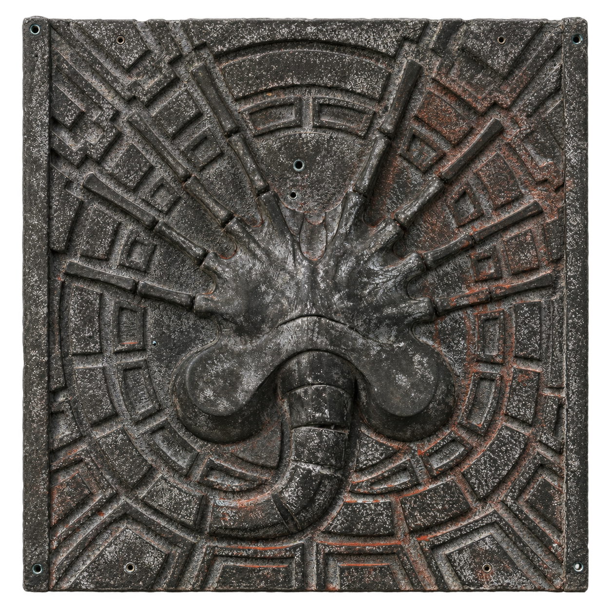
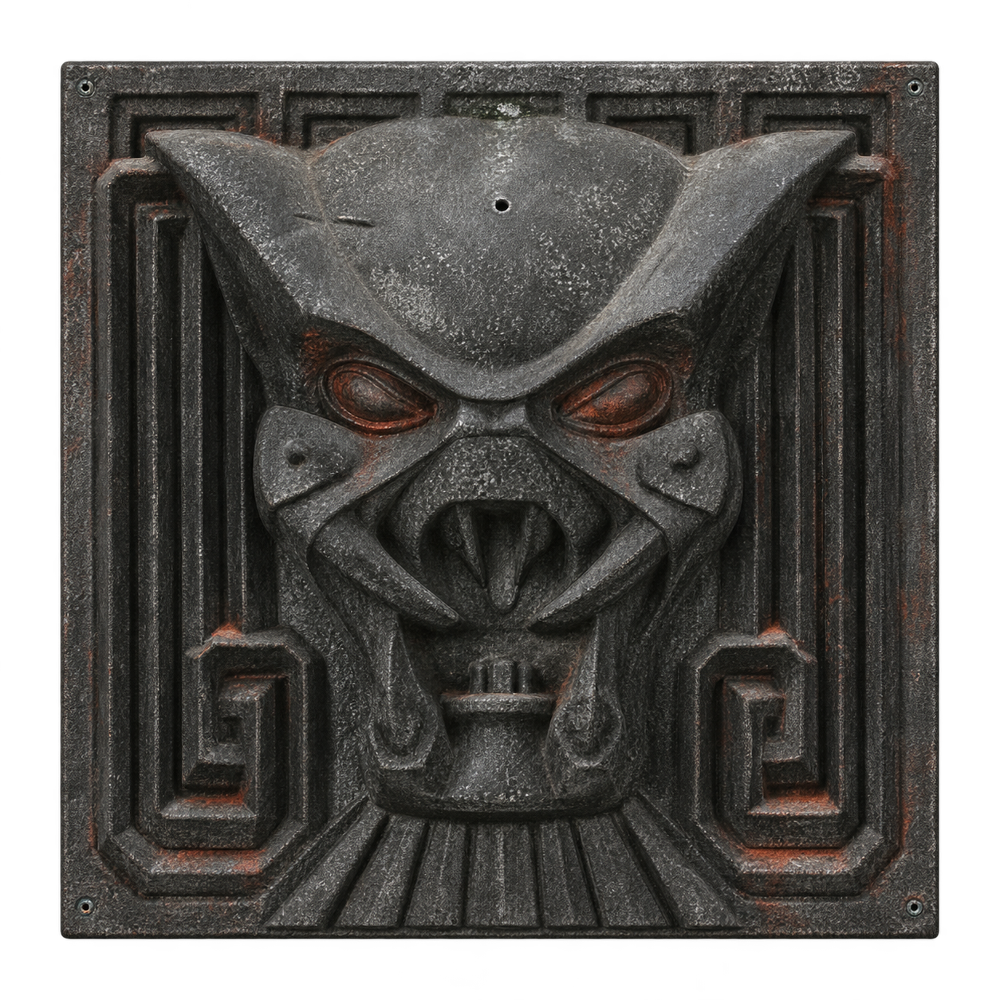

# AVP (2004) — Galerie des trois sources de reliefs

Ces images sont des sources candidates. Voir le [statut de validation](README.md) et le [manifeste complet](manifest.json).

## Panneau mural rituel

887 × 1774 px ; 3,751,193 octets ; RGBA. [Photographie de référence](https://images.propstore.com/3414c49bb1aef860c768365080c641d8-1.jpg) — [fiche de l’accessoire](https://propstore.com/product/avp-alien-vs-predator-2004/lot-509-oversized-antarctic-pyramid-wall-panel/).

SHA256 : `cf8e76405fdf7e7489434e47bc30f72240cb2fd0b6059bfd9c0d1e191802d6a9`.

## Dalle au motif de serpent

1254 × 1254 px ; 4,106,711 octets ; RGBA. [Photographie de référence](https://images.propstore.com/cf3256ca7787729066795ff32996f30f-1.jpg) — [fiche de l’accessoire](https://propstore.com/product/avp-alien-vs-predator-2004/set-of-seven-antarctic-pyramid-tiles/).

SHA256 : `b78e199fcc0796cbbac443cdc41ded38ab0be22c43931e8d3ab8d872e6be3eb6`.

## Dalle au masque (référence de gauche)

1254 × 1254 px ; 3,190,323 octets ; RGBA. [Photographie de référence](https://images.propstore.com/e2afbe5042d9073bf84a87e217f2940e-1.jpg) — [fiche de l’accessoire](https://propstore.com/product/avp-alien-vs-predator-2004/set-of-seven-antarctic-pyramid-tiles/).

SHA256 : `98619e1e4c26c740e322e1f21a29ec9573658ebd52031f87fdff137ddadbee32`.

