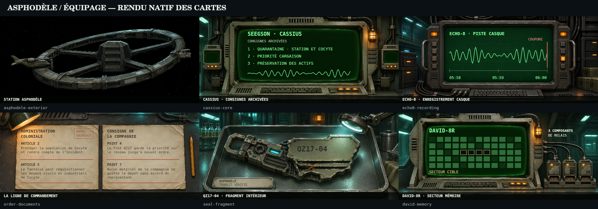

# Asphodèle et premières quêtes — illustrations du 16 novembre 2026

## Résultat et périmètre

Les six emplacements de `src/content-gap-slots-v188.js` disposent maintenant de leurs PNG et de leur raccordement au dialogue de production. Ce lot ajoute **six images, 13 011 481 octets**, au-dessus du commit `1abd0528515e5db460aea06c0e438ca3ceff8ee3`. La PR compte ainsi **49 nouveaux PNG de jeu** : 17 pour les insertions, cinq pour les cales, 18 cartes de colonie/équipage, trois portraits et ces six cartes. Les réutilisations de fichiers plus anciens ne sont pas comptées comme de nouvelles images.

Les six sorties sélectionnées sont copiées **octet pour octet**. Sept sorties ont été générées : la première vue extérieure comportait un cinquième petit bras ; une correction locale avec `image_gen.imagegen` l'a supprimé avant sélection. Les quatre grands rayons, l'anneau, le moyeu et les deux appareils sont conservés. Aucun PNG source n'a été redimensionné ou réencodé.



| Carte | Dimensions du PNG | Preuve et contrôle de fidélité |
| --- | --- | --- |
| `asphodele-exterior` | 1894 × 830 | Anneau incliné, quatre rayons, moyeu sombre, feux éteints, dropship d'Echo-8 à gauche et navette Crucible à droite. |
| `cassius-core` | 1983 × 793 | Grand CRT vert et deux écrans secondaires, aucun visage, consignes archivées et une seule onde vocale native. |
| `echo8-recording` | 1893 × 831 | Boîtier de capteurs existant ; règle 05:58 / 05:59 / 06:00 et repère de coupure dessinés en Canvas. |
| `order-documents` | 1891 × 831 | Deux feuilles ; articles 2 et 5, points 4 et 7 intégralement lisibles ; deux paires de contradictions en rouge et tampon administratif natif. |
| `seal-fragment` | 1891 × 831 | Famille du scellé électronique QZ17 existant ; fragment interne, deux entailles, résine sombre et fibres orange ; numéro QZ17-04 et tampon de transit natifs. |
| `david-memory` | 1896 × 830 | Un CRT et exactement trois relais branchés ; grille de cinq lignes et douze colonnes, secteur cible et légende native. |

## Références et décisions

La [provenance](ASPHODELE_ART_PROVENANCE_20261116.json) conserve les prompts exacts, chaque référence visuelle utilisée, les empreintes, dimensions, tailles et la révision de l'extérieur. La [primitive extérieure](ASPHODELE_ART_PRIMITIVE_REFERENCE_20261116.png) a été fournie au générateur pour la topologie de la station. Le dropship reprend `assets/insertion/v188/ud4l-side.png`, y compris son marquage « 01 » déjà présent. Le scellé se fonde sur la cellule inférieure droite de l'atlas QZ17 V68 ; cette cellule fournit la famille de l'objet intact, tandis que le fragment ouvert répond aux descriptions narratives.

Asphodèle, CASSIUS, les documents, les preuves et le diagnostic de DAVID-8R sont des créations du projet. Le contrôle porte sur les invariants de la bible et les images déjà établies. Cette recette ne certifie pas une copie de scène ou de prop cinématographique « 1:1 ».

Les textes générés ne portent aucune preuve. Le jeu compose les données exactes en français et en anglais sur les surfaces réservées : consignes, articles, identifiants, tampon, règle temporelle et grille. Le tampon de l'Administration porte seulement « ADMIN. / COLONIALE » ou « COLONIAL / ADMIN. », sans date ni signature ajoutée.

CASSIUS est présenté par ses **consignes archivées** : la carte reste juste après les choix de réécrire, brider ou effacer. DAVID indique un **secteur cible** et trois composants ; le fond n'impose ni restauration achevée ni résultat d'effacement des journaux. Le lieu QZ-9 reste sous l'autorité d'Asphodèle, sans nouvelle position géographique supposée.

La divergence de chronologie d'Echo-8 demeure explicitement hors de cette modification : CIN-72 situe une fin à 06:00:05, tandis que la quête sépare le verrouillage à 6:00:05 et la coupure à 6:00:07. La carte conserve la fenêtre commune 05:58–06:00. Sa forme d'onde est illustrative ; elle ne prétend pas transcrire un signal audio échantillon par échantillon.

## Chargement et affichage

`ContentGapAssetLoaderV188` admet explicitement les six chemins existants. Le dialogue `openContentSceneDialogV188` ne demande que la carte courante. La primitive s'affiche pendant le chargement ; l'événement de fin repeint le Canvas sans rejouer les choix, modifier le paragraphe ni déplacer le focus. Les abonnements quittés sont retirés par le dialogue ; un ancien chargement ne ressuscite pas une scène fermée ou remplacée.

Le dessin utilise un recadrage central uniforme, borné aux dimensions du PNG, dans le cadre logique 640 × 280. Il ne déforme pas les sources. Les erreurs réseau, dimensions invalides ou exceptions de dessin conservent le repli sans boucle de requêtes. Les preuves natives sont présentes dans les versions illustrées comme dans les replis.

Le worker source devient `atf-v143-asphodele-art-20261116`. Les **six chemins exacts** rejoignent les 18 cartes de colonie déjà admissibles au cache runtime borné. Aucun des six PNG n'est ajouté au shell. La première consultation télécharge l'image ; après une réponse publique valide, le worker peut la restituer hors ligne. Les portraits existants restent dans le shell. Les chemins voisins, variantes de version ou d'extension, requêtes privées et réponses non admissibles restent refusés.

## Validation native acquise

Le [reçu de rendu](ASPHODELE_ART_RENDER_RECEIPT_20261116.json) porte `provisional: false` et contient les empreintes des trois modules observés, les six sources décodées, leurs coordonnées exactes de recadrage et les empreintes des captures.

- **Six vrais PNG chargés par six requêtes**, tous effectivement dessinés.
- **18 frames** : six replis, six versions françaises et six anglaises.
- **Zéro erreur**, alpha minimal 255 sur chaque carte.
- Focus stable et aucun appel de choix pendant le chargement.
- Revue visuelle des deux langues : articles complets, tampon dégagé, texte des CRT dans les dalles, trois composants de DAVID visibles et indices du scellé non masqués.

L'hôte est déclaré : DOM minimal de test, `Image` local asynchrone, rendu `@napi-rs/canvas`, DejaVu Sans Mono régulier/gras enregistré explicitement. Pillow ne modifie pas les sources : il décode leurs pixels dans une fixture RGBA vérifiée par empreintes, utilisée parce que le décodeur `Image` natif de cet environnement ne charge pas ces PNG. Le dialogue et le chargeur de production effectuent le dessin.

La comparaison de repli utilise le **renderer final avec les images indisponibles**, et non une capture d'une version historique. Ces 18 frames ne constituent pas une qualification Chromium, une mesure de reflow CSS mobile, une session navigateur hors ligne ou un parcours de mission. La rasterisation des fontes du navigateur peut différer.

## Tests et succession de sources

| Contrôle | Résultat acquis |
| --- | --- |
| Scènes de contenu, colonie/équipage et fins de l'Acte V | **59/59**, zéro échec, zéro ignoré |
| Audit et cycle de sauvegarde, dont worker en VM | **132/132**, zéro échec |
| Garde et suite V163 après correction CSS | **37/37**, zéro échec |
| Gardes héritées V156–V162/V165 | **14/14**, zéro échec |
| Contrôles négatifs CSS | Trois modifications invalides refusées comme attendu |

Ces suites se recoupent ; leurs comptes ne sont pas additionnés comme des tests uniques. Les tests ciblés se reproduisent par :

```bash
node --test scripts/verify-content-gaps-v188.mjs scripts/verify-colony-crew-v188.mjs scripts/verify-act5-endings-v188.mjs
npm run test:audit
```

Le lot précédent modifiait `hub-stations-v61.css` sans ajouter son successeur dans le registre terminal V188. Cela bloquait V163 et la validation complète avant leurs étapes navigateur. Le défaut a été reproduit puis corrigé par une entrée exacte, sans changer le CSS : prédécesseur `eaf2b041ec39337b763d6d919859a7f79276c5eff920049980428b365202dfd5`, courant `863d52f5e9b27f5c2395e4619a855a613eeec68290148b09ccbf965593269e57`. Les témoins historiques restent inchangés. Les autres successeurs concernés conservent leur prédécesseur et reçoivent l'empreinte des octets courants.

### Passage complet final

`npm run test:all` a exécuté **274 fichiers de tests uniques** en un seul passage : **4 647 tests, 4 646 réussis, zéro échec, un ignoré, zéro annulé**. Durée du processus : 929,07 secondes. Passage du 16 novembre 2026, de 21 h 38 à 21 h 53 (Europe/Paris). Les sept fichiers surveillés, dont le registre de succession, les slots, le worker et les vérificateurs, conservent exactement les mêmes empreintes entre le début et la fin.

Le seul test ignoré est `V176 optional physical V175 fixture has exact opaque reconstruction`, conditionné par `TANTALUS_V175_ART_ROOT` : cette fixture externe facultative n'est pas renseignée. Les six nouvelles cartes, leurs preuves et leur cycle de chargement ne sont pas ignorés. Les anciens échecs de succession CSS ne sont plus présents.

Empreinte SHA-256 du journal intégral de ce passage : `97d1def734b7f6707f95d030ac3816f58646b48c8388b08e4ed75bd9c07d22b5`.

La publication est conditionnée au contrôle des sources, au build du commit local et à `npm run check:built`. Après création du commit GitHub avec un arbre identique, la distribution est reconstruite et contrôlée sur son SHA exact. Le build ID, l'empreinte de son manifeste et les états CI de ce SHA sont consignés dans la [description de la PR49](https://github.com/darknigthmare/aliens-tantalus-frontier/pull/49), afin de les rattacher au commit publié sans inscrire un identifiant circulaire dans cette recette.

## Limites et suite du travail

Les six cartes complètent les emplacements de scène de ce module. Les **42 emplacements `asph-*`** de décors, props et acteurs jouables restent distincts ; les plans CIN-70 à CIN-72 restent dessinés directement en Canvas. Les poses de personnages, animations et niveaux dédiés ne sont pas achevés par ce lot. La bible et l'audit conservent leurs statuts partiels.

Les cinq documents de provenance/QA de ce lot sont admis par leurs chemins exacts dans les sources et exclus de la distribution. Les sauvegardes, identifiants de quêtes et règles de récompense ne changent pas. Les états CI distants et le déploiement appartiennent à un commit précis ; les anciens succès ne qualifient pas automatiquement ce lot.
