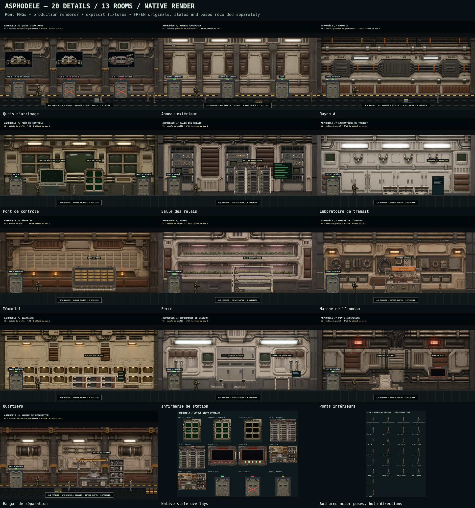

# Asphodèle — vingt détails et acteurs du hub, 17 novembre 2026

## Résultat

Le lot prolonge le commit local des treize parois, `e1d5b9a4e8167e0f5193695f2cea9db4508df35b`, sur la branche `codex/insertion-images-20261116` destinée à la [PR 49](https://github.com/darknigthmare/aliens-tantalus-frontier/pull/49).

Les **vingt derniers emplacements déclarés du hub** disposent désormais de PNG transparents et sont effectivement dessinés par le moteur. Le catalogue atteint **42 images sur 42** : treize parois, vingt détails et neuf objets de mission. Les six cartes de scène Asphodèle constituent un ensemble distinct. Le catalogue illustré n'implique pas que l'ensemble de l'art, des animations ou de la bible soit terminé.

Vingt sorties sont retenues sur vingt-trois générations, pour **37 822 924 octets**. Les trois premières versions rejetées sont tracées dans la provenance. Chaque PNG retenu est copié **octet pour octet** depuis sa sortie de génération ; aucun réencodage, retouche de pixels ou redimensionnement du fichier n'a été effectué. Les fenêtres source et les poses sont sélectionnées au dessin, sans modifier les images.

| Groupe | Images retenues | Contenu intégré |
| --- | ---: | --- |
| Accessoires | 13 | Noyau de CASSIUS, console QZ, baies de transmission, berceaux QZ17, mémorial, hydroponie, étal Crucible, couchettes, lits médicaux, scanner, barricade Echo-8, tableau de ronde, atelier de réparation |
| Éléments intermédiaires | 3 | Porte, UD-4L amarré, navette Crucible |
| Acteurs | 4 | Grue et atlas de docker, marchand, technicien |

Les trois atlas d'ouvriers contiennent **quatre poses dessinées chacun**. Grue dispose d'une pose de repos. Les directions opposées sont produites par retournement dans Canvas.

## Fidélité aux références et à la bible

Les matériaux et assemblages suivent les images inspectées du [portfolio de Paul Abbott, Lead Environment Artist sur Alien: Isolation](https://www.pauldavidabbott.co.uk/alien-isolation) : planche de direction artistique, couloir technique et porte d'habitation. Les costumes des ouvriers et de Grue utilisent trois planches de la [galerie officielle de concepts SEGA](https://alienisolation.sega.jp/special_conceptart.html). Ces dernières sont des concepts de costumes, sans certification qu'ils correspondent à chaque costume final du jeu.

Le Cheyenne utilise deux photographies de la [maquette de tournage d'Aliens présentée par Propstore](https://propstore.com/product/aliens-1986/lot-17-bug-stomper-smart-ass-dropship-model-miniature/), ainsi que la vue du Cheyenne déjà présente dans le projet. La fiche de la maquette signale des restaurations ; ses parties restaurées ne sont pas traitées comme des éléments de production restés intacts.

Les sections 2.3, 7.1 à 7.9 et 42.1 à 42.4 de `docs/narrative/CAMPAGNE_PRINCIPALE.md` guident la continuité narrative. Trois écarts ont conduit à régénérer les images concernées avant intégration :

- **Relais :** la première sortie ne comportait que sept tiroirs par baie. La sélection finale en possède huit, pour les **24 témoins actifs** attendus.
- **Scanner :** le premier linteau réduisait la hauteur libre sous celle du marine. La nouvelle arche conserve environ **96,5 px de passage central**, pour un personnage de **92 px**.
- **Grue :** la première interprétation masculine contredisait la « capitaine récupératrice » de la bible. Le PNG final utilise un personnage féminin ; son visage et son costume restent une interprétation de ce personnage original.

CASSIUS reste un système de gestion sans corps ni visage. Les berceaux QZ17 sont vides ; les informations probantes et leurs inscriptions restent natives. Asphodèle, CASSIUS, Grue, Crucible et Echo-8 sont des créations du projet. **Les références ont été réellement utilisées, mais aucune reproduction canonique « 1:1 » non démontrée n'est certifiée.**

Les [prompts exacts et empreintes](ASPHODELE_HUB_DETAIL_ART_PROVENANCE_20261117.json) indiquent les références effectivement fournies à chaque sortie, les dimensions et l'alpha des vingt sélections, les trois itérations rejetées, les fenêtres source et les ancres natives. Les images de référence primaires ne sont pas ajoutées à la distribution du jeu.

## Composition et états du jeu

Les images sont contenues à rapport uniforme dans leurs emplacements. Les limites utiles ont été mesurées sur les pixels visibles ; les surfaces des écrans et des lampes sont projetées depuis leurs coordonnées source. Les replis en primitives restent disponibles lorsque le chargement échoue.

Les portes conservent leur cadre, leurs voyants et leur croix de verrouillage. Les vaisseaux sont composés dans les hublots, derrière leur cadre natif et devant le fond spatial. La barricade reste un obstacle visuel fermé ; elle n'introduit aucun faux passage dans les rendus contrôlés.

Les fonctions suivantes continuent d'être calculées par le moteur :

- Six écrans du noyau de CASSIUS et formes d'onde selon le choix réécrire, brider ou effacer.
- Vingt-quatre lampes des relais et écran du message retenu.
- Carte QZ, libellés QZ17, archive des livraisons et plan de station distincts.
- ECG, balayage médical, éclairage du mémorial et barres horticoles.
- Texte `CRUCIBLE`, identité `ECHO-8`, marquage `E-8 05:52` et autres textes FR/EN.
- Témoins de ronde et de réparation, étincelles de l'atelier.

Le Cheyenne conserve ses **deux améliorations de gameplay existantes**. La vérification de progression compare les niveaux 0 et 2. Une fixture séparée appelle le helper graphique avec la valeur 3, uniquement pour examiner les trois ancres lumineuses du dessin ; elle ne représente pas un troisième niveau accessible.

Les deux lits médicaux sont prélevés séparément dans leur image, chacun sur **102 px de largeur**, avec l'écart natif de 180 px et les pieds à 624. Les six couchettes occupent **360 × 130 px** et restent au sol, devant les petites alcôves de la paroi. Le scanner occupe **124 × 112 px** ; sa zone de balayage sûre reste dans l'ouverture transparente.

Les ouvriers conservent une hauteur de **89 px** entre les poses. La largeur réelle de la foulée est libre autour d'un pivot de pied fixe, au lieu de comprimer chaque pose dans un rectangle étroit. La marche utilise les poses 1, 2, 3, 2 ; le mode mouvement réduit utilise le repos. Grue est dessinée sur 92 px. Les coordonnées d'interaction, collisions, parcours et formats de sauvegarde ne sont pas modifiés.

## Chargement et distribution

Le hub demande les images de **la salle courante**, à l'entrée puis lors d'un changement de module. Les requêtes déjà lancées sont réutilisées. Les quais chargent six ressources : paroi, porte, deux vaisseaux, Grue et docker. Les neuf images réservées aux missions ne sont pas préchargées par l'entrée dans le hub.

Le cache runtime admet explicitement les vingt nouveaux chemins. Il contient désormais **48 chemins d'images Asphodèle admis** : six cartes et les 42 emplacements. Il ne précharge pas ces PNG à l'installation ; le shell conserve **723 entrées**. Les règles d'origine, de réponse publique, de chemin exact et de contenu demeurent testées. Les quatre documents de ce lot sont admis comme sources de développement et exclus de la distribution publique.

Les empreintes courantes des trois fichiers concernés dans l'audit de succession ont été recalculées, en conservant les empreintes historiques.

## Vérifications exécutées

| Contrôle | Résultat |
| --- | --- |
| Deux suites `verify-asphodele-hub*` | **46 réussites**, 0 échec, 0 ignoré |
| `npm run test:audit` | **132 réussites**, 0 échec, 0 ignoré |
| Suites de continuation V163 et de priorités V188 | **40 réussites**, 0 échec, 0 ignoré |
| `npm run check` sur les sources complètes | **3 466 fichiers**, **1 558 assets**, **0 document privé**, contrôle réussi |
| Revue du chargement par salle | 26 combinaisons : 13 salles × pacte/expulsion de Grue ; toutes les images dessinées appartiennent au chargement de la salle, aucune image de mission demandée |
| Rendu de salles | **13 salles**, **46 captures FR/EN**, 20 nouveaux PNG effectivement utilisés |
| Libellés | **142 libellés suivis**, **19 121 pixels opaques de glyphes comparés**, aucun masquage |
| Cadres de porte | **84 cadres contrôlés**, aucune intrusion de bitmap de détail ou de bande de danger dans les zones réservées |
| Acteurs | **26 combinaisons pose/direction**, erreur d'ancrage des pieds de **0 px** partout |
| États | CASSIUS réécrit/bridé/effacé, relais hors/en ligne, portes ouverte/verrouillée/navette, ronde 0/5, réparation gameplay 0/2 |
| Traçabilité raster | **62 images de preuve**, noms et empreintes conservés dans le reçu ; aucune erreur de contrôle restante |

Les sept nouveaux tests Asphodèle portent sur des risques de l'intégration : demandes de chargement, états natifs, équipements distincts, hublots et marquages, proportions, coordonnées source dans les fichiers définitifs et stabilité des poses/pivots. La revue indépendante des ancres confirme qu'elles restent dans les fenêtres source finales, y compris les deux moniteurs médicaux séparés.

Le passage raster emploie **les véritables PNG et méthodes de dessin de production**, sous `@napi-rs/canvas`, avec sauvegarde, caméra, temps et loader injectés et déclarés dans le [reçu de rendu](ASPHODELE_HUB_DETAIL_ART_RENDER_RECEIPT_20261117.json). La planche ci-dessus est un assemblage de ces captures. Les 61 autres images de preuve restent des sorties locales de QA ; leurs noms, dimensions et empreintes sont enregistrés, sans les distribuer dans le jeu.

Dans les cinq salles larges, l'ancrage géométrique est identique entre les caméras 0 et 128. Les silhouettes à alpha ≥ 128 restent identiques. Le rééchantillonnage natif peut produire des différences minimes : au plus 1/255 en alpha et moins de 2/255 sur les couleurs prémultipliées. Le reçu conserve aussi les écarts RGBA bruts ; ces arrondis ne sont pas présentés comme une identité binaire parfaite de toutes les captures.

Les sources sont restées stables pendant le passage final. Les empreintes des deux renderers sont :

- `src/asphodele-hub-slots-v188.js` : `95d74e5bfb2e3e9e1fd17f5359408c8daf5a97ce73aa1094df9339fb7bbb5f7e`.
- `src/hub-asphodele-v188.js` : `3ef16348c2542192973fa87ac4d71cfe79dcfea665d35659e7f1c836233ecd5a`.

## Limites et suite

Chromium échoue au lancement avec `socket() failed: Operation not permitted` et `ptrace: Operation not permitted`, avant l'ouverture d'une page. **Aucun parcours navigateur, mesure de chargement réseau réel ou essai réel du service worker n'est revendiqué.** Les captures natives ne simulent pas un franchissement de porte au clavier, un combat ou un parcours de sauvegarde/récompense.

Les 42 emplacements déclarés sont couverts. Restent notamment hors de ce lot : le plan V3 de la station, sa rotation visuelle, les illustrations des cinématiques CIN-70 à CIN-72, les autres rôles de PNJ, les nouvelles poses et les objets encore non déclarés. Les quatre poses des trois métiers et le repos de Grue n'équivalent pas à une production complète de toutes les animations du projet.

La publication distante est distincte de la validation locale. Le contrôle automatique d'autorisation a refusé le push vers GitHub ; ce rapport et les fichiers sont donc préparés dans la branche locale en attente de l'accord de publication demandé au propriétaire. Aucun nouveau passage CI distant n'est annoncé pour ce lot.
