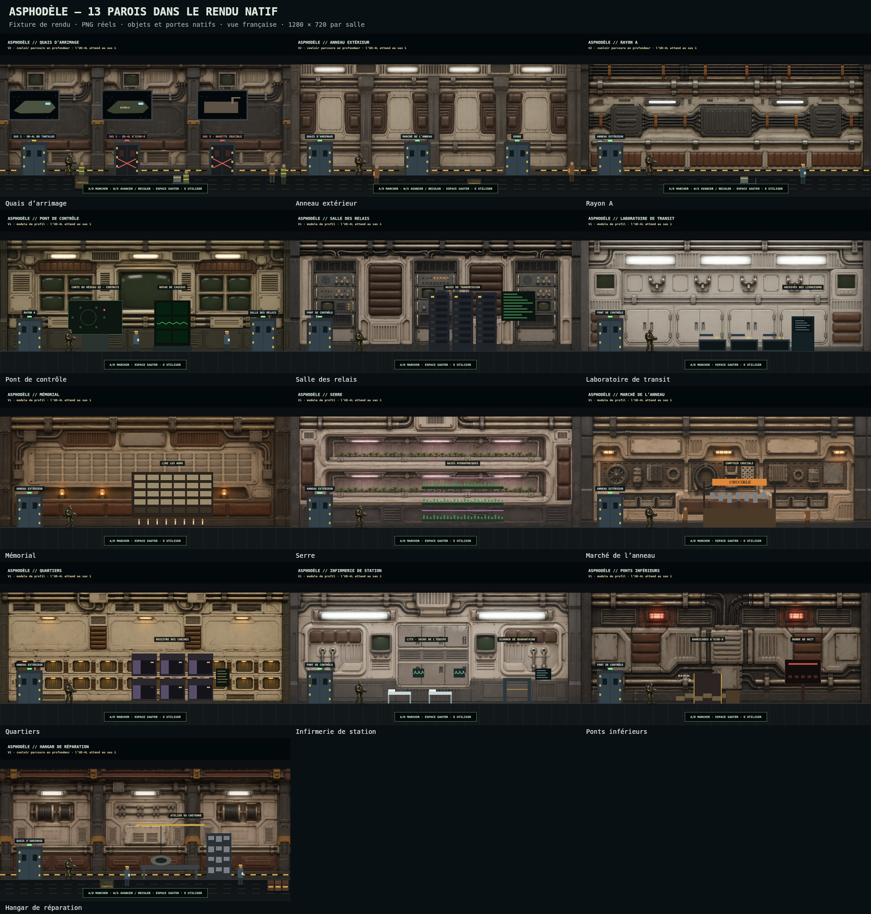

# Asphodèle — treize parois de hub, 17 novembre 2026

## Résultat

Le lot reprend la tête `8fe5d58c33a6ddb9473eb0148019a5f46eaef8bf` de la [PR49](https://github.com/darknigthmare/aliens-tantalus-frontier/pull/49). Les treize emplacements `asph-wall-*` disposent maintenant de PNG indépendants, admis par le loader et composés dans les treize salles existantes.

Quatorze sorties ont été générées ; treize sont retenues, soit **30 419 244 octets**. Une première version des quartiers a été remplacée après le contrôle des proportions. Les fichiers sont copiés octet pour octet : aucun recadrage, réencodage, redimensionnement ni changement de pixels. Les neuf objets de mission du lot précédent restent identiques. Le suivi Asphodèle passe de **9 à 22 emplacements illustrés sur 42** ; **20 éléments du hub restent en primitives**.

| Paroi | PNG source | Contenu produit |
| --- | --- | --- |
| Docks | 1999 × 787 | Tôles rivetées, supports, conduits et boîtiers CRT |
| Anneau | 1983 × 793 | Panneaux ivoire, nervures, inserts capitonnés bruns |
| Rayon technique | 1999 × 786 | Faisceaux de câbles, conduites, brides et main courante |
| Contrôle | 1999 × 786 | Banque de CRT encastrés, grand écran central vide |
| Relais | 1999 × 786 | Modules de transmission encastrés, grilles, lampes ambrées |
| Laboratoire | 1999 × 787 | Panneaux clairs, armoires, rails et attaches d'inspection |
| Mémorial | 1983 × 793 | Plaquettes murales sans noms et lampes électriques ambrées |
| Serre | 1999 × 786 | Deux longues niches végétales et éclairage horticole |
| Marché | 1983 × 793 | Pièces récupérées sur supports, petits bacs et panneaux vides |
| Quartiers | 1999 × 786 | Vingt petites alcôves à rideaux, réparties sur deux rangées |
| Infirmerie | 1983 × 793 | Armoires, raccords de service, moniteurs et panneaux clairs |
| Ponts inférieurs | 1999 × 786 | Conduites, grilles, panneaux réparés et lampes rouges |
| Atelier | 1999 × 787 | Rail supérieur, supports d'outils, enrouleurs et tôles renforcées |

Ces assemblages sont des fonds. Les berceaux, couchettes, trois plateaux hydroponiques du poste interactif, navettes, portes et personnages ne sont pas intégrés dans leur bitmap. La profondeur jouable, les dimensions des acteurs et leurs collisions restent celles du moteur. La première version des quartiers présentait six alcôves trop grandes par rapport au marine. Une correction par le générateur les remplace par vingt petites alcôves sur deux rangées, chacune moins haute que le personnage. Elles restent un habillage de fond ; les couchettes interactives conservent leur propre emplacement.

## Références et portée de la fidélité

Les trois références de continuité sont issues du portfolio de [Paul Abbott, Lead Environment Artist sur Alien: Isolation](https://www.pauldavidabbott.co.uk/alien-isolation) : `ArtStyles.jpg`, `Engineering Corridor.png` et `Habitation_Doorway.jpg`. Elles ont été téléchargées, inspectées et fournies à chacune des treize générations ; leurs empreintes correspondent aux références du lot précédent.

La première est une planche de direction artistique, les deux autres montrent des environnements du jeu. Elles guident les matériaux, formes mécaniques, conduits, moulures et panneaux capitonnés. La caméra perspective des captures n'est pas reprise : chaque sortie est une élévation frontale pour le jeu latéral.

**Asphodèle est une création du projet.** Les treize compositions suivent ses salles et leurs briefs. Les fonds ne sont pas des plans canoniques d'un film ni des reproductions certifiées « 1:1 ». Les noms, cartes QZ et autres informations actives restent des éléments du jeu. Les petites lampes et équipements muraux des fonds constituent un habillage statique ; ils ne représentent pas un nouvel état de mission.

Les [prompts exacts, sources, dimensions et empreintes](ASPHODELE_HUB_WALL_ART_PROVENANCE_20261117.json) conservent la traçabilité de chaque sortie. Les images primaires ne sont pas redistribuées dans le jeu.

## Proportions et raccords

L'ancien appel étirait une image sur toute la largeur visible. Cette largeur variait avec la caméra : pour un exemple 2560 × 1008, le facteur horizontal serait passé de 0,55 à 0,599609375 entre les caméras 0 et 127, tandis que le facteur vertical restait à 0,5.

La méthode `AsphodeleHubAssetLoaderV188.drawWall` utilise la hauteur existante de **504 pixels**, préserve le rapport réel de chaque PNG et répète son contenu à partir de **x = 0 dans le monde**. Les dimensions retournées par le générateur diffèrent légèrement du rapport demandé 1280:504 ; leur rapport réel est conservé, sans étirement.

Un premier rendu par rectangles successifs révélait une colonne partiellement transparente avec l'image de l'anneau, dont la période est fractionnelle. Le chemin final emploie un motif Canvas `repeat-x`, réutilisé pour la même image et le même contexte. Après correction, le contrôle raster ne relève plus de pixel partiellement transparent ni de décalage après translation de la caméra. Le chemin par rectangles reste un secours pour les hôtes minimaux dépourvus de CanvasPattern.

Les parois sont découpées au segment visible et à **y = 120…624**. Le plafond et les bandes de danger sont dessinés par le moteur, au-dessus du fond et sous les portes. Les bandes conservent les interruptions des vrais cadres. Aucun joint artificiel supplémentaire ni porte peinte dans le bitmap n'a été ajouté. Les raccords de matière sont inspectés sur trois répétitions ; la continuité du dessin industriel ne constitue pas une certification de texture identique pixel par pixel aux deux bords.

Le repli en primitives est conservé pendant le chargement et lorsqu'une image manque ou possède des dimensions invalides.

## Vérifications acquises

| Contrôle | Résultat |
| --- | --- |
| Deux suites Asphodèle | **39/39**, aucun échec ni saut |
| Audit et cycle de sauvegarde | **132/132**, aucun échec ni saut |
| Gardes V163 et succession V188 | **40/40**, aucun échec ni saut |
| Contrôle des sources | **3 442 fichiers, 1 538 assets, zéro document privé** |
| Images utilisées par le renderer natif | **13/13** |
| Compositions natives FR/EN | **46 vues** |
| Répétitions de texture | **13 vues × 3 répétitions** |
| Comparaisons avec les primitives | **13 vues** |
| Débordement hors de y = 120…624 | **0 pixel** |
| Pixels non opaques à l'intérieur des fonds | **0** |
| Écart après déplacement de caméra de 128 px | **0 pixel**, pour les treize fonds |
| Masques opaques des portes et postes | **61 contrôles**, **0 pixel modifié** |
| Bandes de danger dans les cadres de porte | **0 pixel** |
| Identité entre PNG généré et fichier runtime | **13/13 identiques** |

Les quatre nouveaux tests de paroi, inclus dans les 39, couvrent plusieurs proportions et positions de caméra, le repli, la transformation du motif et les interruptions de bandes aux portes.

Le [reçu de rendu](ASPHODELE_HUB_WALL_ART_RENDER_RECEIPT_20261117.json) conserve les empreintes des modules, des images et des captures, les dimensions, les mesures de raccord et les états de fixture. L'hôte utilise `@napi-rs/canvas`, les méthodes de rendu du hub de production, les PNG réels et le sprite natif du marine. Les salles, positions de caméra, progression post-S4 et foules figées sont des fixtures déclarées. Ces images attestent la composition ; elles ne constituent pas un parcours de jeu.

Un parcours Chromium au clavier a été préparé à partir du QA existant. **Le navigateur ne s'est pas lancé** : création de socket et ptrace refusées par l'environnement, puis SIGABRT, avant l'ouverture de page. Aucun parcours navigateur, aucune vérification réseau Chromium ni nouvelle mesure de fluidité ne sont donc revendiqués pour ce lot. Les déplacements, portes et sauvegardes sont couverts par les tests du moteur ci-dessus.

Les contrôles de source, de build et de distribution sont exécutés avant publication ; leurs résultats et l'identité du commit sont consignés dans la PR pour éviter une référence circulaire dans ce document.

## Cache et distribution

Le worker source utilise `atf-v143-asphodele-wall-art-20261117`. Les treize chemins exacts rejoignent le cache runtime Asphodèle. Les **723 entrées du shell restent identiques**, et les nouvelles images ne sont pas précachées. Les vingt slots encore absents et les chemins voisins restent refusés.

Les tests du host VM vérifient l'absence de contenu avant une première consultation, la reprise hors ligne après réception d'une réponse publique valide, les requêtes privées et la purge des réponses non admissibles. Ce résultat ne remplace pas un essai hors ligne dans Chromium.

Les quatre documents du lot sont admis précisément dans les sources et exclus du build public. Les trois empreintes courantes concernées dans le registre terminal V188 sont actualisées ; tous leurs prédécesseurs historiques sont conservés.

## Point de reprise

**20 PNG restent à produire pour les slots du hub :**

- Porte ; UD-4L amarré ; navette Crucible.
- Noyau de CASSIUS ; console QZ ; baies de transmission ; berceaux QZ17 ; plaques du mémorial ; baies hydroponiques ; étal Crucible ; couchettes ; lits médicaux ; scanner ; barricade Echo-8 ; tableau de ronde ; établi de réparation.
- Grue ; docker ; marchand ; technicien.

Leurs identifiants, dimensions et fonctions exacts figurent dans le fichier de provenance. Les animations des acteurs, la rotation visuelle de l'anneau, les plans cinématiques et les autres chantiers déjà ouverts gardent leur statut distinct. Ce lot termine les treize fonds du hub, sans clore l'ensemble de l'art de la station.

