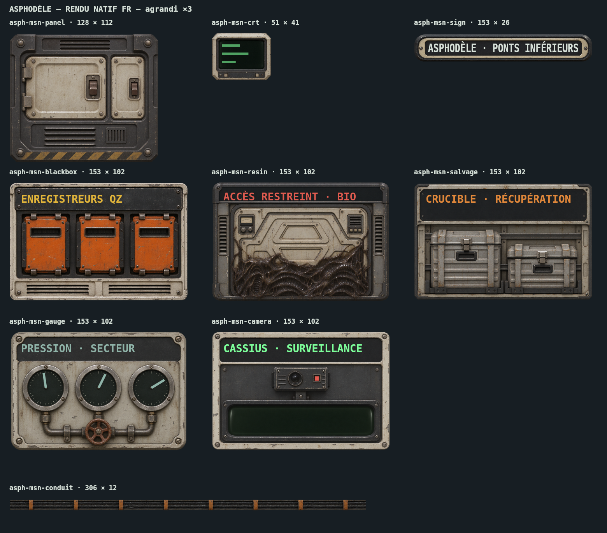

# Asphodèle — neuf objets de mission, 16 novembre 2026

## Résultat

Les neuf emplacements `asph-msn-*` disposent de leurs images et de leur raccordement au moteur de production, au-dessus de `3be2a402aa2e8149b4fb3bc557d9ba67a75523d8`. Les neuf sorties générées ont été retenues, soit **20 552 215 octets**. Chaque PNG est copié octet pour octet ; aucune retouche des pixels, réduction ou réencodage n'a été appliqué. La PR compte désormais **58 nouveaux PNG de jeu** : 17 insertions, cinq objets des cales, 18 cartes de colonie/équipage, trois portraits, six cartes Asphodèle et ces neuf objets.



| Objet | Cadre de jeu | Composition contrôlée |
| --- | --- | --- |
| Panneau | 128 × 112 | Deux accès mécaniques, rivets, bande de danger |
| CRT | 51 × 41 | Verre sombre et trois lignes d'état animées en Canvas |
| Plaque de secteur | 153 × 26 | Cadre vide, texte FR/EN natif contenu dans la dalle sombre |
| Conduits | 306 × 12 | Trois câbles parallèles et huit brides orange |
| Enregistreurs QZ | 153 × 102 | Trois boîtiers orange distincts |
| Trappe et résine | 153 × 102 | Trappe fermée, résine sur sa partie inférieure, avertissement natif |
| Récupération Crucible | 153 × 102 | Deux caisses, hauteurs décalées et base commune |
| Pression | 153 × 102 | Trois cadrans, aiguilles natives et volant de vanne |
| Surveillance CASSIUS | 153 × 102 | Une caméra, un voyant natif, un écran vert sombre, aucun visage |

Les [prompts exacts et empreintes](ASPHODELE_MISSION_ART_PROVENANCE_20261116.json) identifient les cinq images primaires utilisées, les guides de géométrie et les fenêtres de prélèvement. La [planche des primitives](ASPHODELE_MISSION_ART_PRIMITIVE_REFERENCE_20261116.png) documente le point de départ.

## Références et fidélité

Trois images du portfolio de [Paul Abbott, Lead Environment Artist sur Alien: Isolation](https://www.pauldavidabbott.co.uk/alien-isolation), ont été téléchargées, inspectées et fournies au générateur : `ArtStyles.jpg`, `Engineering Corridor.png` et `Habitation_Doorway.jpg`. Elles donnent les matériaux, le câblage et les formes de porte. La planche de direction artistique ne prouve pas à elle seule la forme d'un accessoire final.

Deux captures de l'[article de Gary Napper sur le système de sauvegarde](https://www.gamedeveloper.com/design/game-design-deep-dive-the-save-system-of-i-alien-isolation-i-) ont également été utilisées : le terminal à commandes mécaniques et une zone cargo avec des caisses. La seconde est une vue d'ensemble ; ses détails fins restent limités. Le plan de Dallas devant Mother a été inspecté mais n'a pas été fourni au générateur. La [présentation officielle SEGA](https://alienisolation.sega.jp/special_conceptart.html) documente le choix d'une construction pratique compatible avec 1979 et de matériaux fonctionnels.

Les assemblages QZ, Crucible, pression et CASSIUS, les libellés Asphodèle et leurs dimensions sont ceux du projet. Les pages des artistes Tunde Glover, Liam Tart et Brad Wright ont été identifiées, mais leurs images de props précis n'ont pas été récupérées. Elles ne servent donc pas de preuve d'un contour observé. La résine reprend le motif cité par la bible, sans gros plan primaire inspecté dans cette passe. La fidélité porte sur les références effectivement vues et la composition du jeu ; **aucune certification de réplique canonique « 1:1 » n'est revendiquée**.

Les images primaires servent de références ; leurs fichiers ne sont pas redistribués comme assets runtime.

## Rendu et intégration

`AsphodeleHubAssetLoaderV188` admet uniquement les neuf fichiers présents. Son préchargement par défaut reste limité aux slots du hub ; les missions appellent explicitement la liste des neuf objets. Une visite du hub ne télécharge donc pas ce lot. Le loader conserve ses chemins de primitive pendant le chargement et en cas d'échec.

`drawAsphodeleMissionSlotV188` compose l'image puis les éléments natifs dans un clip aux dimensions du slot. La mise à l'échelle est uniforme et les fenêtres source retirent seulement les marges du canevas lors du dessin. Des pixels alpha très faibles existent loin de certains contours ; les fenêtres inspectées isolent la silhouette utile sans modifier les octets des PNG. Le conduit reste à son échelle de 306 px et est rogné en bout de travée, sans compression horizontale.

Les cinq libellés de mission et les quatre secteurs gardent leurs formulations FR/EN. Les lignes du CRT et les trois aiguilles continuent de varier avec le temps. Les pivots des aiguilles sont projetés depuis les coordonnées du PNG, par la même transformation que l'image. Le voyant CASSIUS est dessiné dans son logement mesuré ; son verre statique reste celui de l'image. Les primitives gardent leurs ancres propres. Le texte de secteur dispose d'une marge adaptée au cadre et le titre de la trappe est remonté de deux pixels dans le chemin image.

La comparaison au commit de départ confirme que **le bloc de calcul du plan est identique**. Les marges de 18 px, le rythme de 306 px, le plafond y = 110, la bande de danger de 5 px et l'unique élément de mission restent inchangés. Les quatorze campagnes concernées sont couvertes. Le renderer du hub reste identique ; aucune collision, règle de progression, ressource ou sauvegarde ne dépend de l'image.

## Cache

Le worker source utilise `atf-v143-asphodele-mission-art-20261116`. Les neuf chemins exacts rejoignent les 18 cartes colonie et six cartes Asphodèle déjà admises au cache runtime. Les **723 entrées du shell sont identiques** ; les neuf PNG ne sont pas précachés. Le plafond de 256 médias et les contrôles de requêtes/réponses restent ceux du worker existant.

Les tests du host VM vérifient l'échec hors ligne avant le premier chargement, puis le repli après réception d'une réponse publique valide. Ils refusent les chemins voisins, les emplacements du hub encore absents, les requêtes privées et les réponses non admissibles. Ces tests ne constituent pas un parcours hors ligne dans Chromium.

## Vérifications acquises

| Contrôle | Résultat |
| --- | --- |
| Deux suites Asphodèle | **35/35**, aucun échec ni saut |
| Audit et cycle de sauvegarde, dont cache runtime | **132/132**, aucun échec ni saut |
| Gardes V163 et succession V188 | **40/40**, aucun échec ni saut ; 106 successeurs contrôlés |
| Contrôle des sources | **3 425 fichiers, 1 525 assets, zéro document privé** |
| Images finales dans le renderer natif | Neuf FR, neuf EN, neuf replis |
| Vues du moteur de production | Dix captures 1280 × 720 : cinq types d'élément de mission, deux langues |
| Bornes raster | 18 contrôles ; **zéro pixel hors du slot** |
| Animation entre t = 0 et t = 2 | CRT : 58 pixels changés ; aiguilles : 132, dans les deux langues |
| Alpha et identité des sources | Neuf RGBA, contours transparents et empreintes identiques aux sorties sélectionnées |

Commandes ciblées :

```bash
node --test scripts/verify-asphodele-hub-v188.mjs scripts/verify-asphodele-hub-2-v188.mjs
npm run test:audit
```

Le [reçu de rendu](ASPHODELE_MISSION_ART_RENDER_RECEIPT_20261116.json) conserve les empreintes des modules, les fenêtres, les résultats raster et les empreintes des captures. L'hôte est `@napi-rs/canvas`, avec décodage direct des vrais PNG par `loadImage` et les API navigateur du host existant `engine-host-v188.mjs`. Les images n'ont pas été remplacées par des fixtures de couleur.

Les vues du moteur utilisent la seed 7 de la fixture de production, avec ennemis, escouade et dangers désactivés, et caméra placée sur l'élément à inspecter. Elles attestent la composition, **pas un parcours de mission ni une capture navigateur**. Les captures EN contrôlent les overlays du lot ; le HUD environnant conserve les chaînes françaises de la fixture. La revue a porté sur les neuf objets dans les deux langues, les replis et les dix compositions. Une seconde revue indépendante n'a relevé aucun problème matériel dans le diff ou les quantités représentées.

## Distribution et portée restante

Les cinq documents du lot sont admis par leurs chemins exacts dans les sources et restent exclus de la distribution publique. Les empreintes courantes des sources protégées sont actualisées dans le registre terminal V188, en conservant les témoins et prédécesseurs historiques.

Les contrôles des sources, du build et de l'artefact sont exécutés avant publication. Le SHA du commit publié, le build ID, l'empreinte du manifeste et l'état de ses workflows sont consignés dans la [PR49](https://github.com/darknigthmare/aliens-tantalus-frontier/pull/49), afin de les rattacher au commit exact sans identifiant circulaire dans ce document. Le passage complet Node du lot précédent appartient à `3be2a40` ; il n'est pas présenté comme un nouveau passage sur ces fichiers.

Les échecs navigateur constatés sur `3be2a40` restent distincts : pause de Trials après reprise, contrôle de retour bloqué par l'overlay d'extraction V188, terminal de sauvegarde à temporisation pendant une pause et dialogue Forge absent après reprise. Aucun correctif de ces parcours n'est inclus dans le présent lot graphique ; les résultats de la nouvelle tête doivent être suivis séparément.

**33 emplacements du hub Asphodèle restent sans PNG**, ainsi que les poses de personnages, la rotation visuelle de l'anneau et les plans cinématiques distincts. Les neuf images de mission n'achèvent pas ces contenus. La bible et l'audit conservent un statut partiel.
