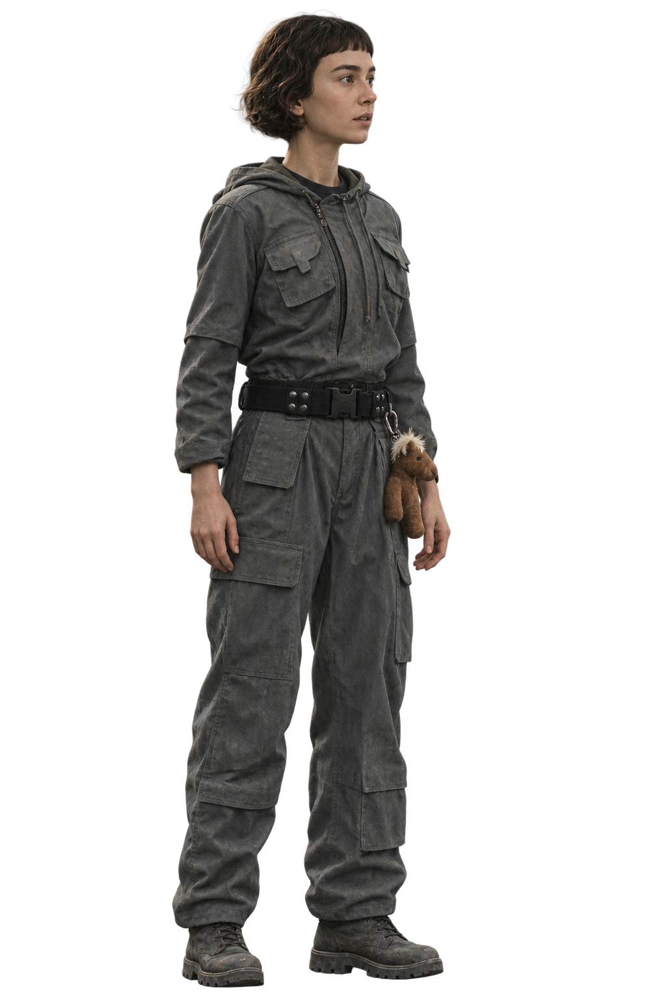
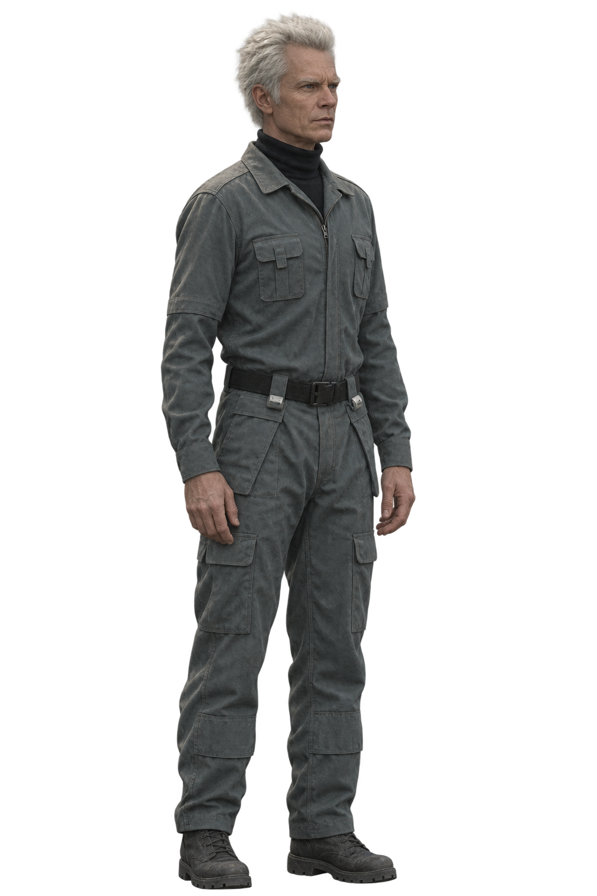
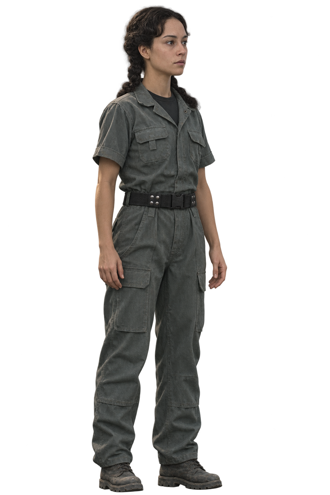
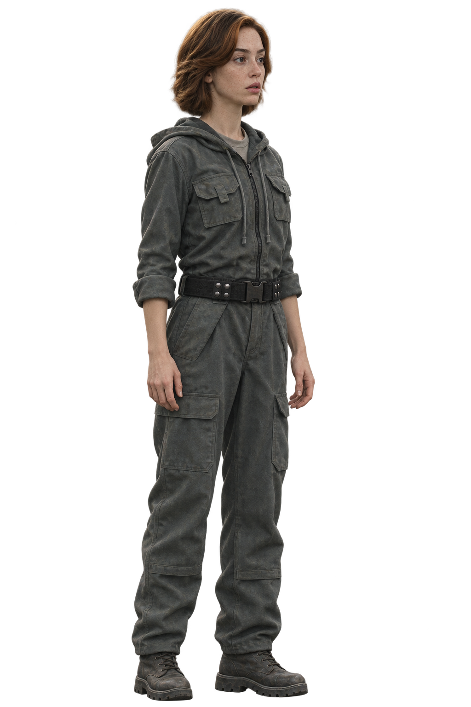
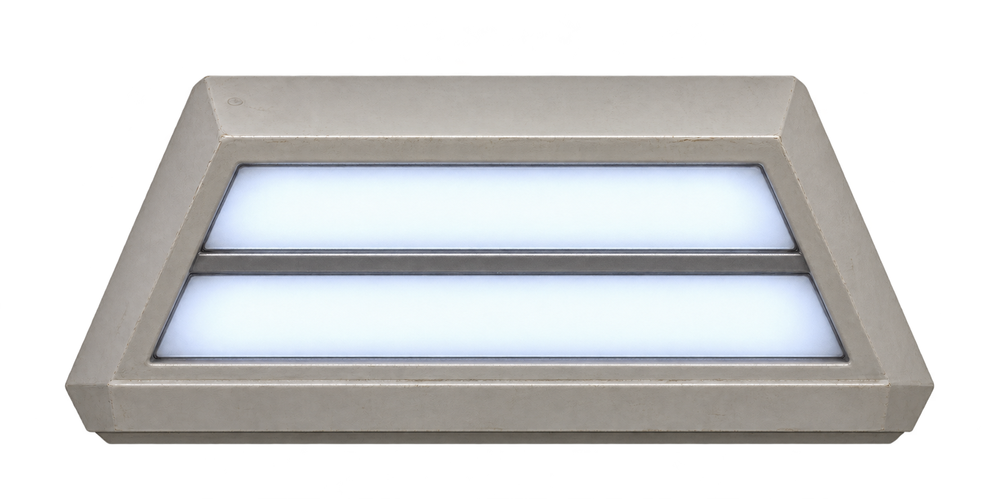
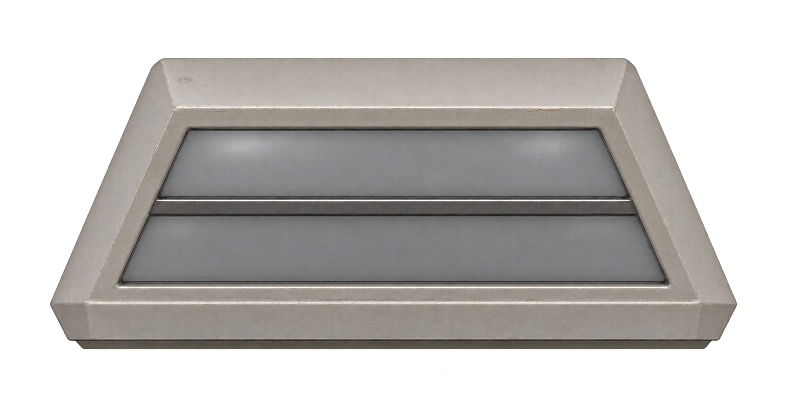
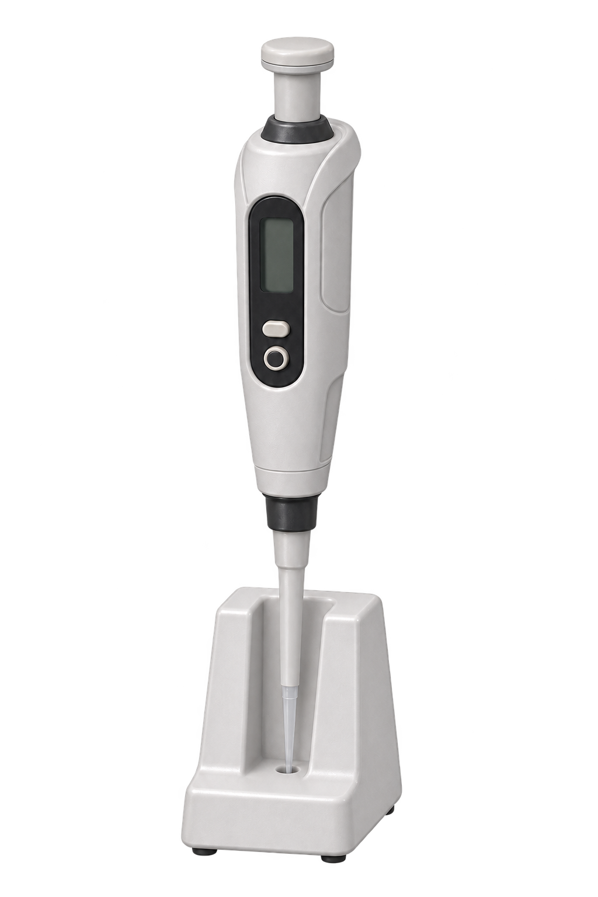

# Alien: Earth — intégration et sprites V12

Cette révision restaure le module V11 complet, raccorde son lancement depuis le Tantalus et conserve quinze PNG individuels. Sept images sont nouvelles depuis le point de récupération initial PR78. Les rapports QA distinguent les tests du module, les contrôles du fichier autonome et les allers-retours vers l’hôte, avec leurs fixtures et leurs limites.

## Ressources et usages

| Ressource | Surface raccordée | Périmètre |
| --- | --- | --- |
| MCS-X | Monde et catalogue | Fusil autonome, profil droit. Aucun autre armement remplacé. |
| Species 19 — adulte | Monde | Profil tick adulte uniquement. Une pose ; animation non générée. |
| Joe / Hermit — MCS-X, attente | Monde et catalogue | Joe immobile, MCS-X, sans casque. Fusil inclus dans le PNG ; aucun doublon. Exclure déplacement, accroupissement, conduit bas, portage et costume de chapitre d’index 6. |
| Zoo — cylindre de confinement | Monde | R18-0 et R18-4 uniquement, trois cylindres sur support continu ; conserver l’emprise physique. |
| Zoo — console murale | Monde | R18-wall1 et R18-wall3 uniquement. Support mural original y210–267 ; pas de substitution de R18-1 au premier plan. |
| Zoo — table de laboratoire | Monde | R18-island seulement, largeur 195, profondeur 52, hauteur 75. Le bas de la table n’est pas intégralement visible dans la référence. |
| Zoo — meuble à vitrages dépolis | Monde | Décor mural R18, centré à x450 et posé à y300 ; hors panneau de nom, portes et volumes de collision. |
| Arthur — état sain, attente | Monde et catalogue | Arthur sain immobile uniquement. Le portrait ne documente pas entièrement le pantalon et les chaussures. Exclure explicitement eye_host. |
| Wendy — tenue de sauvetage | Monde et catalogue | C03/index 2 seulement, idle debout et mains libres ; joueur et aperçu. Les actions et le massicot gardent leur rendu animé. |
| Kirsh — tenue grise | Catalogue | Catalogue et sélecteur idle sain sans arme. Aucune tâche talk ne fait apparaître ce sprite comme PNJ dans la campagne actuelle. |
| Curly — tenue de sauvetage | Catalogue | Catalogue C03/index 2, idle mains libres. La tâche talk existante est en R21/C06 : ce costume C03 ne la remplace pas. |
| Nibs — tenue de sauvetage | Catalogue | Catalogue C03/index 2, idle mains libres. Aucun PNJ talk ou survivant Nibs présent dans les données actuelles. |
| Zoo — applique allumée à deux bandes | Aperçu de référence | Référence visuelle et aperçu de validation. Le sélecteur alimenté est prêt, mais R18 reste intrinsèquement hors tension. |
| Zoo — applique éteinte à deux bandes | Monde | État réellement utilisé sur R18-wall0, R18-wall2 et R18-wall4, sans modifier alimentation ni collisions. |
| Zoo — pipette et support | Monde | Décoration posée sur R18-island lorsque la table raster est dessinée ; aucun nouveau volume de collision. |

Kirsh, Curly et Nibs sont actuellement des silhouettes de catalogue ; leur présence en campagne n’est pas revendiquée. Les poses et détails masqués sont adaptés, et aucune image n’est certifiée identique à l’écran. Les animations restent à compléter.

## Jouer et générer les fichiers

Le fichier `JOUER_ALIEN_EARTH_V12.html` contient le code, les styles et les quinze images. Il se télécharge puis s’ouvre directement dans le navigateur. La sauvegarde utilise l’espace Earth ; le bouton de retour au Tantalus apparaît dans la version servie depuis l’hôte.

Le ZIP `ALIEN_EARTH_V12_MODULE_PUBLIC.zip` contient les quarante fichiers du module public, sous `dlc/alien-earth/v12/`. Cette édition utilise des modules JavaScript : servir le dossier extrait avec un serveur HTTP local, ou l’intégrer à la distribution native.

Les deux fichiers sont produits par le workflow [Alien Earth DLC](https://github.com/darknigthmare/aliens-tantalus-frontier/actions/workflows/alien-earth-dlc.yml), dans l’artefact `alien-earth-v12-playable` conservé trente jours. Les sources et la commande de reconstruction restent dans le dépôt :

```sh
npm run test:dlc:earth
node scripts/build-alien-earth-dlc.mjs --standalone --output=earth-export/JOUER_ALIEN_EARTH_V12.html
```

## Documentation

- [BIBLE.md](BIBLE.md) : 25 personnages, 70 salles, 49 types de props, 8 profils de créatures, armes, outils, véhicules, terrains et manquants connus.
- [inventory.json](inventory.json) : inventaire structuré détaillé, portails et sources V11 conservées avec leur date d’origine.
- [manifest.json](manifest.json) : 15 chemins, empreintes, dimensions, références et périmètre de chaque ressource.
- [references.md](references.md) : provenance et limites des photographies, portraits et concepts.
- [generation-ledger.json](generation-ledger.json) : prompts utilisés et deux corrections ciblées des nouveaux props.
- [CONTINUATION.md](CONTINUATION.md) : reprise technique, historique de panne et vérifications.
- [Rapport navigateur](qa/browser-report.json) et [rapport de tests](qa/test-report.json) : résultats, versions testées, historique des essais et limites.

## Aperçus des sept nouvelles ressources

### Wendy — tenue de sauvetage



C03/index 2 seulement, idle debout et mains libres ; joueur et aperçu. Les actions et le massicot gardent leur rendu animé.

### Kirsh — tenue grise



Catalogue et sélecteur idle sain sans arme. Aucune tâche talk ne fait apparaître ce sprite comme PNJ dans la campagne actuelle.

### Curly — tenue de sauvetage



Catalogue C03/index 2, idle mains libres. La tâche talk existante est en R21/C06 : ce costume C03 ne la remplace pas.

### Nibs — tenue de sauvetage



Catalogue C03/index 2, idle mains libres. Aucun PNJ talk ou survivant Nibs présent dans les données actuelles.

### Zoo — applique allumée à deux bandes



Référence visuelle et aperçu de validation. Le sélecteur alimenté est prêt, mais R18 reste intrinsèquement hors tension.

### Zoo — applique éteinte à deux bandes



État réellement utilisé sur R18-wall0, R18-wall2 et R18-wall4, sans modifier alimentation ni collisions.

### Zoo — pipette et support



Décoration posée sur R18-island lorsque la table raster est dessinée ; aucun nouveau volume de collision.

## Huit ressources conservées

| Ressource | Fichier |
| --- | --- |
| MCS-X | [mcsx.png](../../../modules/alien-earth/v12/assets/raster-v12/mcsx.png) |
| Species 19 — adulte | [species19-adult.png](../../../modules/alien-earth/v12/assets/raster-v12/species19-adult.png) |
| Joe / Hermit — MCS-X, attente | [joe-mcsx-idle.png](../../../modules/alien-earth/v12/assets/raster-v12/joe-mcsx-idle.png) |
| Zoo — cylindre de confinement | [zoo-cylinder.png](../../../modules/alien-earth/v12/assets/raster-v12/zoo-cylinder.png) |
| Zoo — console murale | [zoo-console.png](../../../modules/alien-earth/v12/assets/raster-v12/zoo-console.png) |
| Zoo — table de laboratoire | [zoo-lab-table.png](../../../modules/alien-earth/v12/assets/raster-v12/zoo-lab-table.png) |
| Zoo — meuble à vitrages dépolis | [zoo-cabinet.png](../../../modules/alien-earth/v12/assets/raster-v12/zoo-cabinet.png) |
| Arthur — état sain, attente | [arthur-idle.png](../../../modules/alien-earth/v12/assets/raster-v12/arthur-idle.png) |
