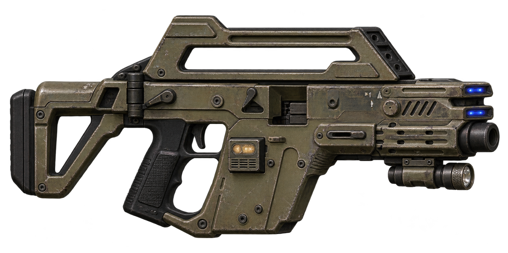
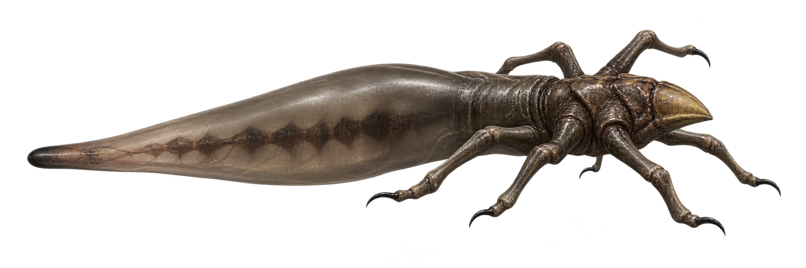
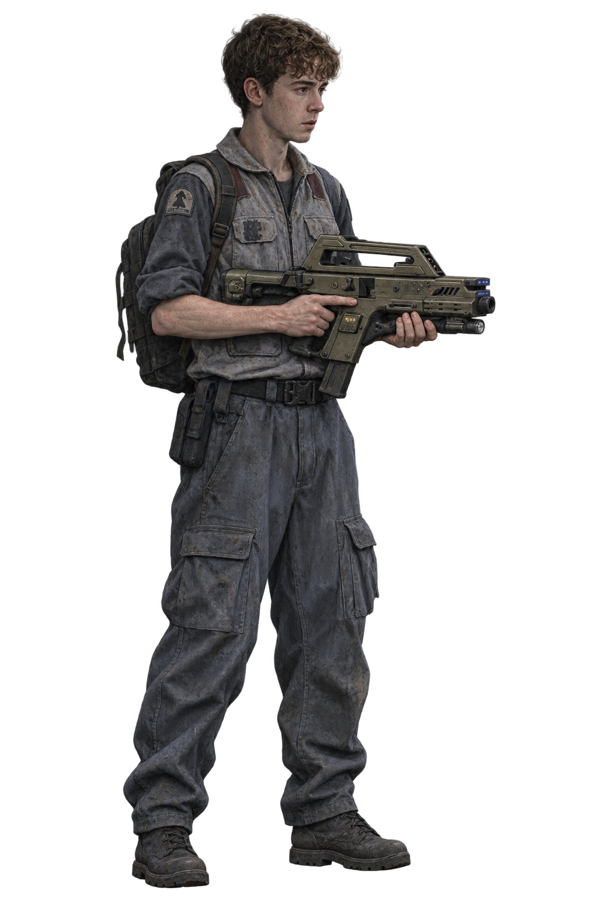
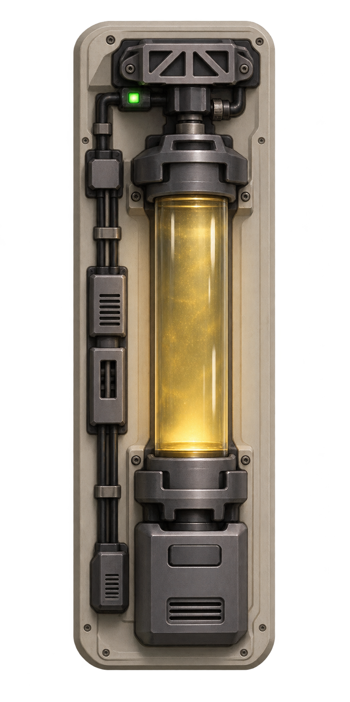
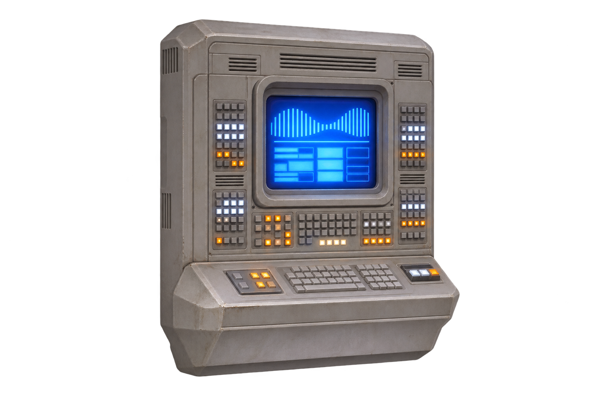
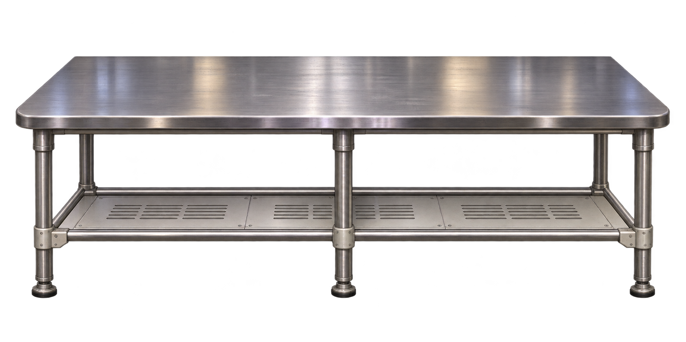
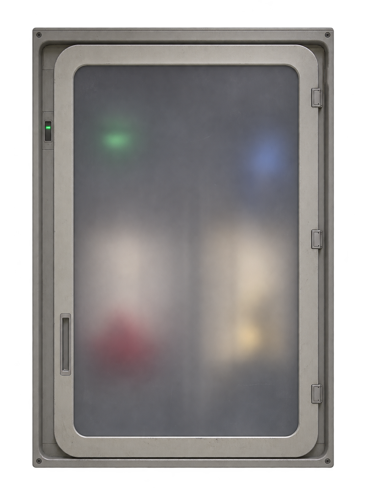
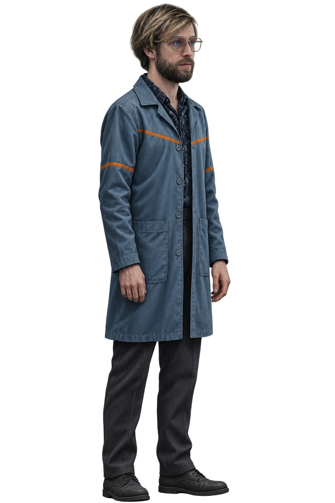

# Alien: Earth — reprise V12 des sprites

Date : 26 novembre 2026.

**Ce point de reprise conserve huit PNG individuels et leur documentation. Le raccord complet au jeu n’est pas livré dans ce commit.** L’environnement d’exécution est devenu indisponible avant le build final, les tests raster et les contrôles visuels du jeu.

Les huit fichiers sont les sorties PNG originales, avec canal alpha, sans retouche ni réencodage. Les prompts effectivement utilisés figurent dans [generation-ledger.json](generation-ledger.json). Les signatures PNG, dimensions IHDR, empreintes SHA‑256 et identifiants des blobs Git sont consignés dans [manifest.json](manifest.json).

## Contenu conservé

| Ressource | Dimensions | État du travail local avant interruption |
|---|---:|---|
| [MCS-X](../../../modules/alien-earth/v12/assets/raster-v12/mcsx.png) | 1774 × 887 | Raccord local écrit, non validé |
| [Species 19 — adulte](../../../modules/alien-earth/v12/assets/raster-v12/species19-adult.png) | 2172 × 724 | Raccord local écrit, non validé |
| [Joe / Hermit — MCS-X, attente](../../../modules/alien-earth/v12/assets/raster-v12/joe-mcsx-idle.png) | 1024 × 1536 | Raccord local écrit, non validé |
| [Zoo — cylindre de confinement](../../../modules/alien-earth/v12/assets/raster-v12/zoo-cylinder.png) | 887 × 1774 | Raccord local écrit, non validé |
| [Zoo — console murale](../../../modules/alien-earth/v12/assets/raster-v12/zoo-console.png) | 1536 × 1024 | Raccord local écrit, non validé |
| [Zoo — table de laboratoire](../../../modules/alien-earth/v12/assets/raster-v12/zoo-lab-table.png) | 1774 × 887 | À raccorder |
| [Zoo — meuble à vitrages dépolis](../../../modules/alien-earth/v12/assets/raster-v12/zoo-cabinet.png) | 1086 × 1448 | À raccorder |
| [Arthur — état sain, attente](../../../modules/alien-earth/v12/assets/raster-v12/arthur-idle.png) | 1024 × 1536 | À raccorder |

Le code local de raccord n’a pas été transféré dans ce point de reprise. « Raccord local écrit » ne signifie donc ni disponible dans cette branche, ni validé en jeu. Les cinq premières ressources avaient des hooks locaux ; Arthur, la table et le meuble restaient à finaliser.

La tentative de génération du Xénomorphe Maginot a été refusée par l’outil et n’a livré aucun PNG. Le dessin Canvas existant reste la solution de repli. Une ancienne mention de quatorze PNG n’a pas pu être matérialisée : ces fichiers ne sont pas comptabilisés comme livrés.

## Documents

- [BIBLE.md](BIBLE.md) : périmètre du DLC, personnages, créatures, équipement, décor et limites de fidélité.
- [inventory.json](inventory.json) : inventaire structuré des données V11 et de la couverture de cette reprise.
- [references.md](references.md) : sources primaires et nature de chaque référence.
- [CONTINUATION.md](CONTINUATION.md) : état exact de l’implémentation interrompue, correction de sauvegarde restante et contrôles à reprendre.
- [manifest.json](manifest.json) : dimensions, empreintes, rôles et états d’intégration.
- [generation-ledger.json](generation-ledger.json) : prompts et références de chaque génération, y compris la tentative sans image.

## Fidélité et couverture

L’objectif reste la fidélité visuelle à Alien: Earth. Aucun de ces PNG n’est certifié identique à l’écran. Le concept officiel de Species 19 représente une étape de conception ; le portrait d’Arthur ne montre pas toute sa tenue ; certains détails inférieurs de la table ont été déduits. Ce sont des limites de preuve explicitement suivies, et non des éléments considérés comme finalisés.

Le lot comprend deux poses humaines, une pose de créature, une arme autonome et quatre éléments de décor. Il ne constitue pas un jeu complet d’animations. Il ne remplace pas les autres personnages, créatures, véhicules, fonds de salle ou textures planétaires.

## Validation observée

Avant les dernières modifications locales, les tests du module V11 et la régression de sauvegarde ont donné **1 220 réussites sur 1 220**. Ces résultats ne valident pas le registre raster final, les huit images dans le moteur, ni l’ouverture et le retour depuis le véritable menu hôte.

Dans ce point de reprise, les contrôles de signature PNG, de dimensions et de format ont réussi sur les huit sorties originales. Les empreintes SHA‑256 ont été calculées sur leurs octets exacts. **Build final, tests raster, contrôle des sauvegardes à l’entrée du DLC et parcours navigateur restent à exécuter.**

## Aperçus des fichiers conservés

### MCS-X

Fusil autonome, profil droit. Aucun autre armement remplacé.

### Species 19 — adulte

Profil tick adulte uniquement. Une pose ; animation non générée.

### Joe / Hermit — MCS-X, attente

Joe immobile, MCS-X, sans casque. Fusil inclus dans le PNG ; aucun doublon. Exclure déplacement, accroupissement, conduit bas, portage et costume de chapitre d’index 6.

### Zoo — cylindre de confinement

R18-0 et R18-4 uniquement, trois cylindres sur support continu ; conserver l’emprise physique.

### Zoo — console murale

R18-wall1 et R18-wall3 uniquement. Support mural original y210–267 ; pas de substitution de R18-1 au premier plan.

### Zoo — table de laboratoire

Prévu seulement pour R18-island, largeur195/profondeur52/hauteur75. Le bas de la table n’est pas intégralement visible dans la référence.

### Zoo — meuble à vitrages dépolis

Prévu comme décor mural R18, hors panneau de nom, portes et volumes de collision. Placement à vérifier en jeu.

### Arthur — état sain, attente

Arthur sain immobile uniquement. Le portrait ne documente pas entièrement le pantalon et les chaussures. Exclure explicitement eye_host.

