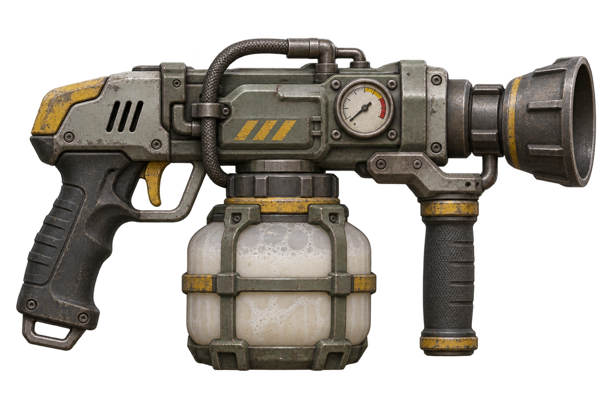
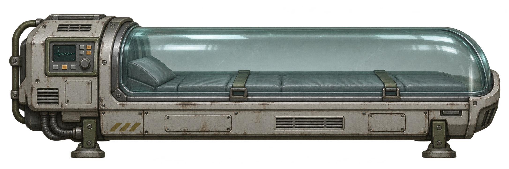
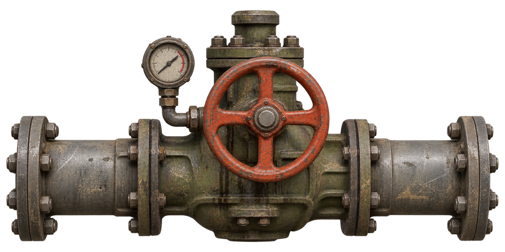
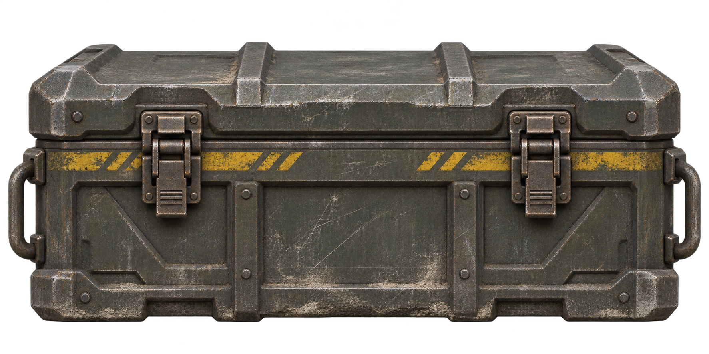
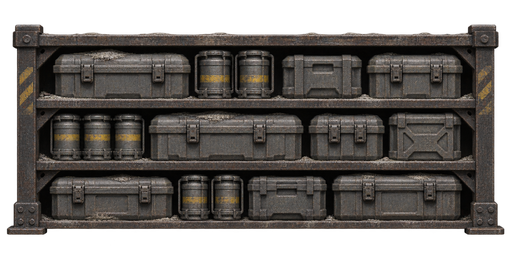
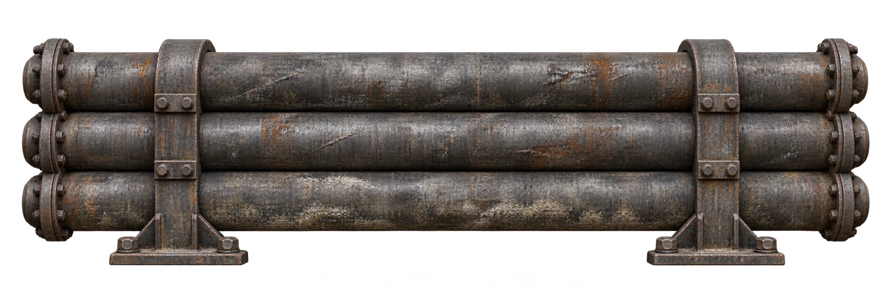
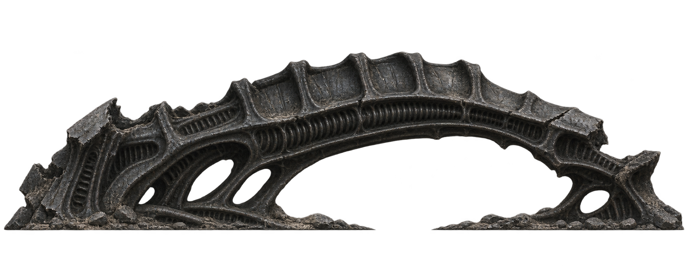
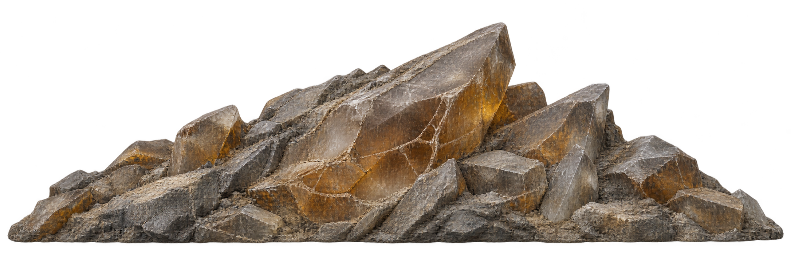
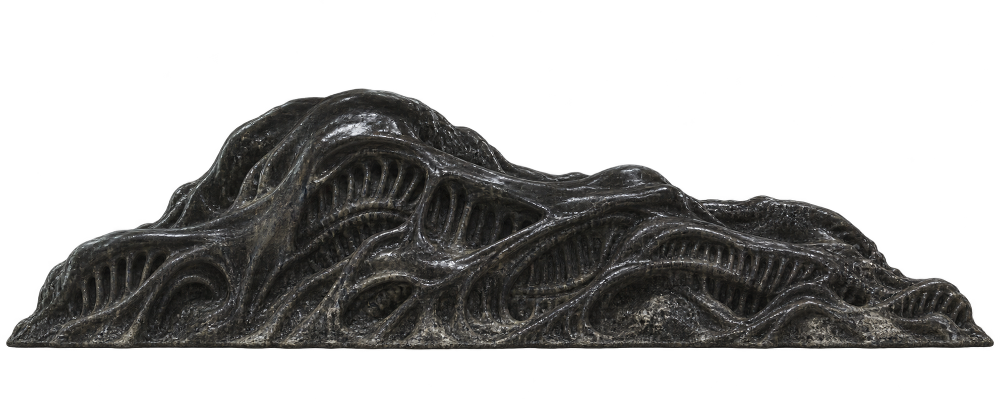

# La Mer des Chagrins — sprites du 26 novembre 2026

Ce point de reprise conserve **27 PNG individuels** : **9 nouveaux sprites** produits pendant cette reprise et **18 images antérieures** retrouvées sous forme de blobs Git vérifiés. Il complète la PR #58.

**Ces fichiers sont des sources de production. Ils ne sont pas encore activés dans le jeu.** Le moteur v0.10.0 et les sauvegardes restent inchangés. L’environnement d’exécution est devenu indisponible avant le raccordement final et la publication de la fusion locale.

## Les neuf nouveaux sprites

| Sprite | Dimensions | Fichier |
|---|---:|---|
| Foamer de capture | 1536 × 1024 | [PNG](sprites/weapons/foam.png) |
| Capsule de stase | 2172 × 724 | [PNG](sprites/decor/cryo.png) |
| Vanne industrielle | 1774 × 887 | [PNG](sprites/decor/valve.png) |
| Caisse de fret | 1774 × 887 | [PNG](sprites/obstacles/crate.png) |
| Rayonnage chargé | 1774 × 887 | [PNG](sprites/obstacles/rack.png) |
| Faisceau de conduites | 2172 × 724 | [PNG](sprites/obstacles/pipe.png) |
| Nervure de structure extraterrestre | 1983 × 793 | [PNG](sprites/obstacles/rib.png) |
| Éboulis de silice | 2172 × 724 | [PNG](sprites/obstacles/silica-rubble.png) |
| Amas de résine | 1983 × 793 | [PNG](sprites/obstacles/resin.png) |

Les six familles d’obstacles correspondent aux types déjà employés par **120 placements** de la campagne. La capsule et la vanne correspondent aux deux familles de décors encore absentes. Le foamer complète l’appareil de capture ; sa forme est une interprétation visuelle du projet.

## Aperçu

### Foamer de capture

### Capsule de stase

### Vanne industrielle

### Caisse de fret

### Rayonnage chargé

### Faisceau de conduites

### Nervure de structure extraterrestre

### Éboulis de silice

### Amas de résine

## Images antérieures récupérées

Douze personnages : Decker, Manning, Adams, Harriman, Rollins, Elway, Rand, Cho, Bronson, Badejo, Silas et le personnel médical.

Cinq décors : carottier, casier, poste médical, bobine et ambre. Un équipement : capteur de terrain.

Leurs blobs ont été résolus par GitHub avant la création de cet arbre. Ils ne sont pas comptés comme de nouvelles générations.

## État précis de la reprise

- Le lot local inspecté contenait 110 PNG, tous distincts, décodables et dotés d’un canal RGBA avec pixels transparents.
- Ce point de reprise en conserve 18. **92 images antérieures restent à récupérer et à publier**.
- Les sept images annoncées dans une passe ultérieure n’ont pas été retrouvées ; elles ne sont pas comptées.
- Le générateur n’a pas livré les quatre images suivantes : adulte xénomorphe, reine, fusil plasma, lance-flammes.
- Les 48 points d’ancrage de décors hors dimensions ont été identifiés ; leur correction n’a pas été finalisée.
- Les deux brancards portent une orientation non reconnue dans le manifeste local ; leur correction reste à appliquer.

## Correctifs et validations locaux, non publiés

Deux corrections de rendu ont été écrites et testées avant l’indisponibilité de l’environnement : repli vers une pose PNG utilisable lorsqu’une image prioritaire échoue ; suppression du second agrandissement du parasite royal sur les brancards. Leurs **40 tests ciblés** ont réussi.

La fusion avec la branche cumulative a été résolue localement, avec **17 tests d’admission, 15 tests de succession et 15 tests de menus** réussis. Cette fusion et ces correctifs ne sont pas inclus comme modifications actives dans ce point de reprise.

Aucun nouveau résultat de build complet ni parcours Chromium n’est revendiqué. Le binaire navigateur était indisponible, puis l’environnement entier est devenu inaccessible.

## Fidélité et provenance

Chaque nouveau fichier provient d’un appel distinct au générateur d’images. Les prompts exacts, dimensions, tailles et identifiants de blobs sont dans [MANIFEST.json](MANIFEST.json).

La [fiche Titan Books](https://titanbooks.com/6484-alien-sea-of-sorrows-book-2/) confirme le cadre du roman de James A. Moore. Les visages, silhouettes d’objets et détails non établis par les références consultées restent des interprétations du projet. **Fidélité 1:1 globale non certifiée ; cycles complets d’animation non fournis.**

## Reprise technique

[RECOVERY.md](RECOVERY.md) conserve les décisions, les corrections à reprendre et les identifiants utiles sans attribuer aux sources publiées les validations de la version locale.
