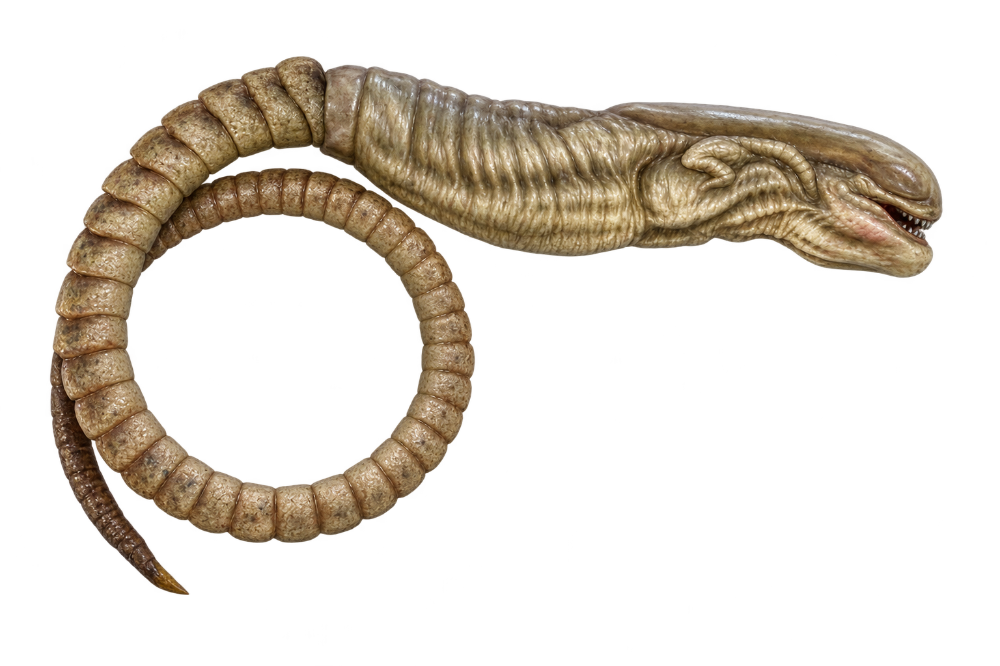
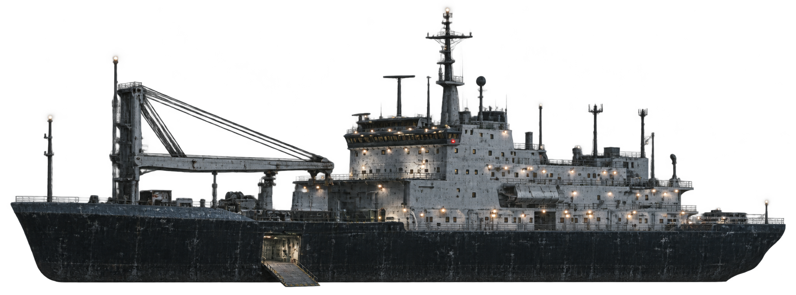
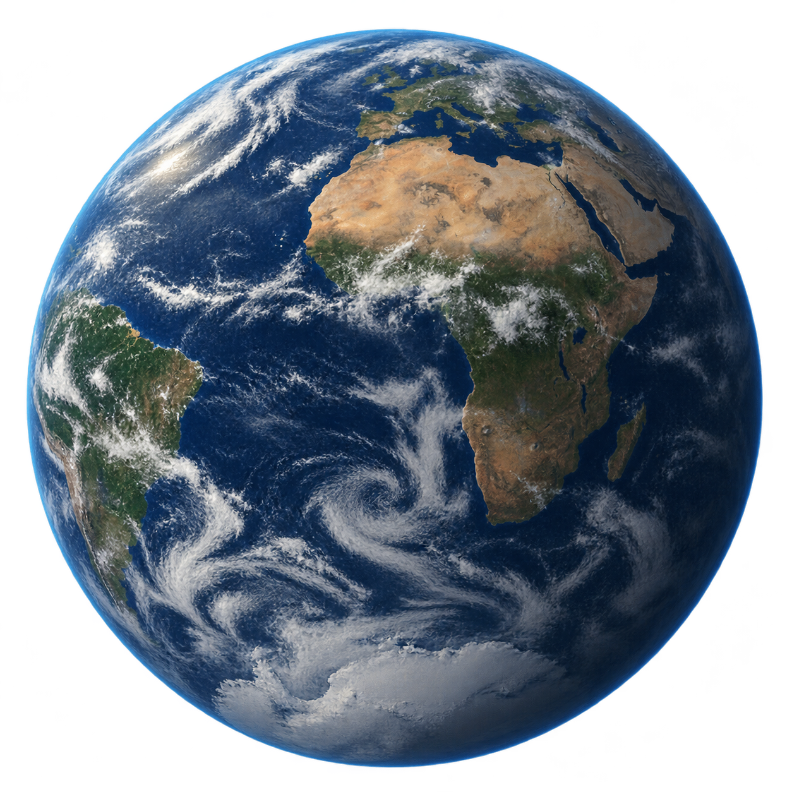
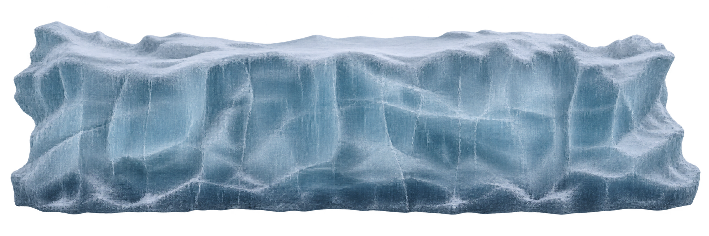
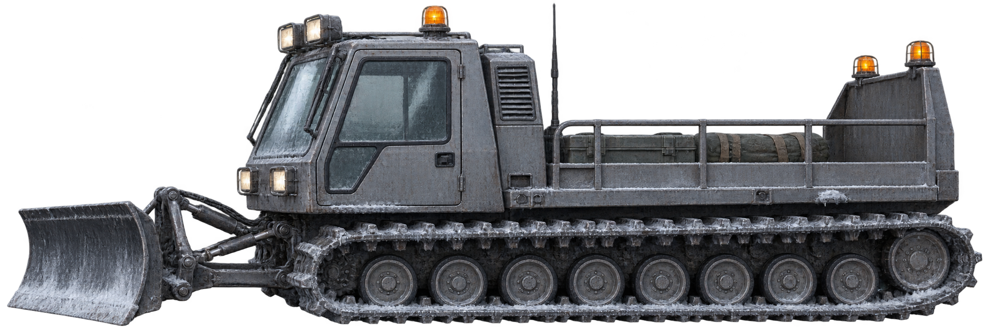
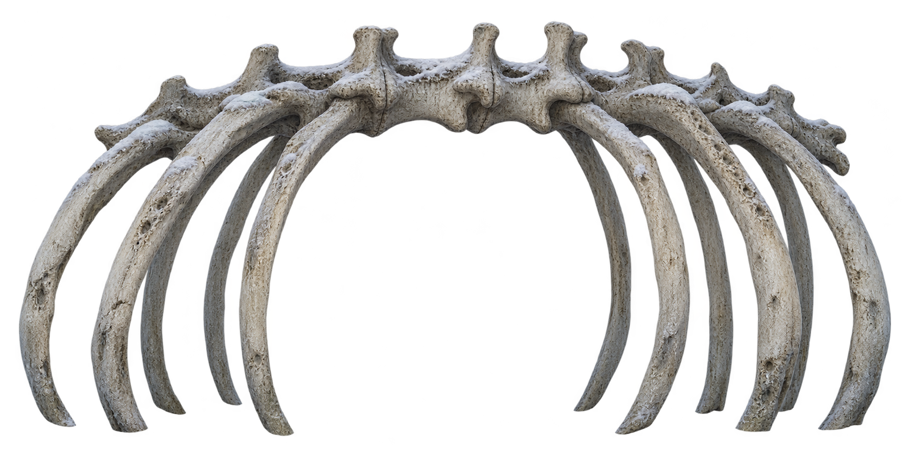
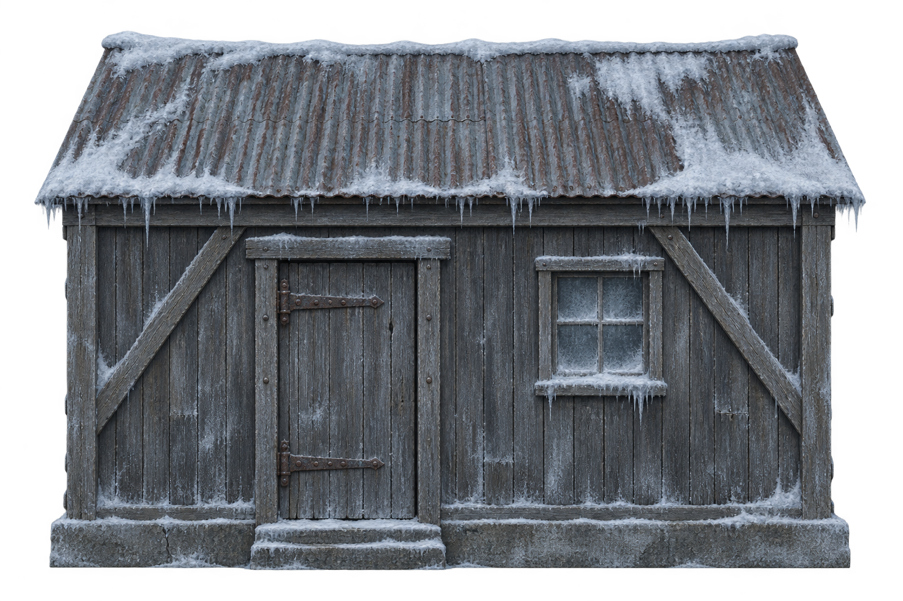
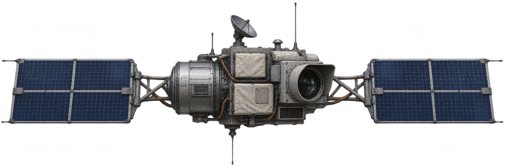

# AVP (2004) — galerie de production v001

[Bible détaillée](README.md) · [Spécifications individuelles](PRODUCTION_SPECIFICATIONS.md) · [Manifeste et prompts complets](manifest.json)

**Huit PNG individuels — 17 031 468 octets.** Génération réalisée avec **imagegen intégré**, transparence demandée, originaux conservés. Deux images ont reçu une référence visuelle en entrée ; six ont été générées à partir de texte.

Chaque image est un **candidat de travail**, avec `runtimeIntegrated:false`, `exact:false`, `canonExact:false` et `productionReady:false`. Cette galerie ne présente pas des captures du jeu. Les écarts signalés doivent être corrigés avant une admission au rendu.

Le manifeste conserve le prompt exact de chaque tentative, les sources lues, les références visuelles réellement fournies, les empreintes, les dimensions et les observations. Les images générées ne servent pas elles-mêmes de preuve de l’apparence du film.

## Vue d’ensemble

| Visuel | Dimensions | Octets | Entrée visuelle |
| --- | --- | ---: | --- |
| [Chestburster standard](../../../../assets/openai/sprites/avp2004-production-v001/chestburster-human-avp2004-v001.png) | 1536 × 1024 | 1 886 251 | Oui |
| [Piper Maru — coque complète](../../../../assets/openai/sprites/avp2004-production-v001/piper-maru-avp2004-v001.png) | 2057 × 764 | 1 534 498 | Oui |
| [Terre — élément d'établissement](../../../../assets/openai/sprites/avp2004-production-v001/earth-avp2004-v001.png) | 1254 × 1254 | 2 505 530 | Non — texte |
| [Paroi de glacier](../../../../assets/openai/sprites/avp2004-production-v001/glacier-face-avp2004-v001.png) | 2172 × 724 | 2 400 997 | Non — texte |
| [Snowcat Weyland — candidat de profil](../../../../assets/openai/sprites/avp2004-production-v001/snowcat-avp2004-v001.png) | 2172 × 724 | 2 338 215 | Non — texte |
| [Ossements de baleine](../../../../assets/openai/sprites/avp2004-production-v001/whalebone-arch-avp2004-v001.png) | 1774 × 887 | 1 794 042 | Non — texte |
| [Façade de station baleinière](../../../../assets/openai/sprites/avp2004-production-v001/whaling-station-facade-avp2004-v001.png) | 1536 × 1024 | 3 164 936 | Non — texte |
| [Satellite Weyland — candidat](../../../../assets/openai/sprites/avp2004-production-v001/weyland-satellite-avp2004-v001.png) | 2172 × 724 | 1 406 999 | Non — texte |

## 1. Chestburster standard

Une pose indépendante du chestburster issu d’un hôte humain, avec queue entière. Le prop ADI sert de référence d’apparence ; cette image ne représente pas le Predalien de l’épilogue.

**Identifiants :** `AVP2004-054` ; bible `creature_chestburster`.

**Provenance de génération :** référence visuelle fournie au générateur.

**Revue du résultat :** Silhouette complète et queue visibles. Teinte, petits bras, dents et proportions à comparer au prop et aux plans. La pose fixe ne fournit ni naissance ni locomotion. Le contenu runtime reste ABSENT.

**Travail avant intégration :** Comparer la tête, les petites extrémités, la dentition, la teinte et la longueur relative du corps ; produire ensuite les états de scène nécessaires avant tout raccord.

**Sources :** [PROP_CHESTBURSTER](https://propstoreauction.com/lot-details/index/catalog/359/lot/118656). [Preuve de présence dans le runtime](INVENTORY.md).

**Fichier :** [chestburster-human-avp2004-v001.png](../../../../assets/openai/sprites/avp2004-production-v001/chestburster-human-avp2004-v001.png) — 1536 × 1024 — 1 886 251 octets. SHA-256 : `e2c0680ad987e86b8e1a6d31504f975a2f5539ae86381622289d933ed893de24`.

## 2. Piper Maru

Un navire complet en profil, avec un accès et une rampe raccordés à la coque. Le plan nocturne fourni ne permettait pas de relever tous les détails ; ils restent reconstruits.

**Identifiants :** `AVP2004-113` ; bible `ship_piper_maru`.

**Provenance de génération :** référence visuelle fournie au générateur.

**Revue du résultat :** Coque entière, ouverture et rampe reliées au navire. La projection de profil, les fenêtres et détails peu visibles dans le plan nocturne sont des reconstructions. Comparer à la miniature John Lee avant admission. Marge de tête faible autour du mât.

**Travail avant intégration :** Comparer à la miniature de fabrication de John Lee, corriger fenêtres, ponts, grue, mât et proportions ; définir les scènes d’approche et d’embarquement.

**Sources :** [FILM_PIPER](https://avp.fandom.com/wiki/Piper_Maru) · [JOHN_LEE](https://www.johnleemodelmaker.me/avp.aspx). [Preuve de présence dans le runtime](INVENTORY.md).

**Fichier :** [piper-maru-avp2004-v001.png](../../../../assets/openai/sprites/avp2004-production-v001/piper-maru-avp2004-v001.png) — 2057 × 764 — 1 534 498 octets. SHA-256 : `af035524b7d63ef535c84a490edc72dea780a5116cd73b46baca5831a7d5079c`.

## 3. Terre

Une image orbitale indépendante pour le contexte terrestre d’AVP 2004. Il n’est ajouté aucune planète étrangère à ce périmètre.

**Identifiants :** complément de production ; bible `planet_earth`.

**Provenance de génération :** génération textuelle ; les références liées ci-dessous n’ont pas été fournies comme pixels.

**Revue du résultat :** Afrique, Atlantique et calotte australe reconnaissables. Aucun relevé des côtes, nuages, orientation ou éclairage du plan AVP ; cette image ne sert pas de carte de navigation ni de géographie certifiée.

**Travail avant intégration :** Comparer le cadrage, la phase d’éclairage, les continents et nuages à la scène exacte ; ne pas utiliser cette interprétation comme carte.

**Sources :** [NASA_EARTH](https://science.nasa.gov/resource/the-blue-marble/). [Preuve de présence dans le runtime](INVENTORY.md).

**Fichier :** [earth-avp2004-v001.png](../../../../assets/openai/sprites/avp2004-production-v001/earth-avp2004-v001.png) — 1254 × 1254 — 2 505 530 octets. SHA-256 : `0f63616322aa67e9a8c0366857622128f00a92917399807250fa1e63edb75b3b`.

## 4. Paroi glaciaire

Un module de glace et de neige destiné à étudier le sol, la silhouette et les couches de décor. C’est une matière originale de travail, sans métrique filmique.

**Identifiants :** complément de production ; bible `terrain_glacier`.

**Provenance de génération :** génération textuelle ; les références liées ci-dessous n’ont pas été fournies comme pixels.

**Revue du résultat :** Module de matière et de silhouette original. Raccords non testés, répétition non garantie, aucun collider défini. Ne reproduit pas une paroi mesurée du film.

**Travail avant intégration :** Tester les bords adjacents, la répétition, la lisibilité des contacts au sol et les séparations de profondeur ; définir les collisions à partir du niveau, pas du halo de l’image.

**Sources :** [MPC_AVP](https://www.mpcvfx.com/en/filmography/alien-vs-predator/). [Preuve de présence dans le runtime](INVENTORY.md).

**Fichier :** [glacier-face-avp2004-v001.png](../../../../assets/openai/sprites/avp2004-production-v001/glacier-face-avp2004-v001.png) — 2172 × 724 — 2 400 997 octets. SHA-256 : `86af606156957fd985e67a2d578fa881844deb4fd129acb219752385296a8704`.

## 5. Snowcat Weyland

Une silhouette de chenillé comprenant cabine, plateau, lame avant et feux. La génération a reçu du texte, pas les pixels de la miniature Propstore.

**Identifiants :** `AVP2004-115` ; bible `vehicle_snowcat`.

**Provenance de génération :** génération textuelle ; les références liées ci-dessous n’ont pas été fournies comme pixels.

**Revue du résultat :** Chenilles, cabine, plateau, lame et feux présents. Rapport cabine/plateau, nombre de feux/galets et livrée restent à corriger par photo ; inscriptions non dessinées volontairement. Pas de véhicule pilotable livré.

**Travail avant intégration :** Reprendre la proportion cabine/plateau, le train roulant, les feux, les panneaux et la livrée à partir d’une photographie exploitable ; ne pas recopier une cote de miniature comme taille du véhicule réel.

**Sources :** [PROP_SNOWCAT](https://propstoreauction.com/lot-details/index/catalog/496/lot/192510/460-Light-Up-Weyland-Antarctic-Snowcat-Model-Miniature-AVP-ALIEN-VS-PREDATOR-2004). [Preuve de présence dans le runtime](INVENTORY.md).

**Fichier :** [snowcat-avp2004-v001.png](../../../../assets/openai/sprites/avp2004-production-v001/snowcat-avp2004-v001.png) — 2172 × 724 — 2 338 215 octets. SHA-256 : `6c7b3b7840660de29c8a71c7324d71b116964cceadc704719cdd37fd949bad94`.

## 6. Arche d’ossements de baleine

Un prop indépendant évoquant la station baleinière, avec des ouvertures visibles entre les côtes. La sortie conserve un angle de profondeur.

**Identifiants :** complément de production ; bible `prop_whaling_equipment`.

**Provenance de génération :** génération textuelle ; les références liées ci-dessous n’ont pas été fournies comme pixels.

**Revue du résultat :** Prop complet avec ouvertures entre côtes. La projection conserve de la profondeur et ne satisfait pas encore le profil latéral strict ; anatomie, nombre de côtes et échelle de scène non validés.

**Travail avant intégration :** Ramener la projection au profil demandé, relever l’anatomie et le nombre de côtes dans la scène, vérifier l’échelle avec les personnages et préserver l’ouverture praticable.

**Sources :** [FILM_WHALING](https://clip.cafe/alien-vs-predator-2004/what-are-these-whale-bones/). [Preuve de présence dans le runtime](INVENTORY.md).

**Fichier :** [whalebone-arch-avp2004-v001.png](../../../../assets/openai/sprites/avp2004-production-v001/whalebone-arch-avp2004-v001.png) — 1774 × 887 — 1 794 042 octets. SHA-256 : `92507c5ceb5f8d947d57b7486bc271e37d59b7f09314960b58af9c4a0340c976`.

## 7. Façade de station baleinière

Une façade continue avec porte, jambages, linteau et seuil. Elle sert de proposition architecturale ; elle ne correspond pas encore à une façade du film identifiée.

**Identifiants :** complément de production ; bible `loc_station_wide`.

**Provenance de génération :** génération textuelle ; les références liées ci-dessous n’ont pas été fournies comme pixels.

**Revue du résultat :** Porte, jambages, linteau et seuil appartiennent à une façade continue. Bâtiment original de travail, sans preuve de correspondance à une façade filmée. Dégagement, ouvrant, occlusion et raccord de sol à intégrer et tester ; aucun remplacement de salle.

**Travail avant intégration :** Identifier la façade cible, refaire sa silhouette et ses détails, séparer l’ouvrant si nécessaire puis vérifier l’occlusion, l’interaction et l’arrivée de l’autre côté.

**Sources :** [FILM_WHALING](https://clip.cafe/alien-vs-predator-2004/what-are-these-whale-bones/) · [MPC_AVP](https://www.mpcvfx.com/en/filmography/alien-vs-predator/). [Preuve de présence dans le runtime](INVENTORY.md).

**Fichier :** [whaling-station-facade-avp2004-v001.png](../../../../assets/openai/sprites/avp2004-production-v001/whaling-station-facade-avp2004-v001.png) — 1536 × 1024 — 3 164 936 octets. SHA-256 : `3ec8f5337de6645259600d65e072bf85283f65799c8c83f3e7287d862c1a87a2`.

## 8. Satellite Weyland

Un candidat orbital au corps et aux panneaux reliés. La page du maquettiste John Lee a été lue ; sa photographie n’a pas été fournie comme entrée à cette génération.

**Identifiants :** complément de production ; bible `prop_satellite`, `loc_earth_orbit`.

**Provenance de génération :** génération textuelle ; les références liées ci-dessous n’ont pas été fournies comme pixels.

**Revue du résultat :** Panneaux raccordés au corps et silhouette entière au seuil alpha128. Géométrie textuelle provisoire, orientation non strictement orthographique et marge très faible aux extrémités. La maquette John Lee doit guider une prochaine itération ; livrée exacte absente.

**Travail avant intégration :** Reprendre la géométrie sur la maquette de production, obtenir une projection adaptée au jeu et augmenter les marges avant le contrôle des attaches et du cadrage.

**Sources :** [JOHN_LEE](https://www.johnleemodelmaker.me/avp.aspx). [Preuve de présence dans le runtime](INVENTORY.md).

**Fichier :** [weyland-satellite-avp2004-v001.png](../../../../assets/openai/sprites/avp2004-production-v001/weyland-satellite-avp2004-v001.png) — 2172 × 724 — 1 406 999 octets. SHA-256 : `8283a5cdd918c5e92d78f97d511e0336201a67817598494cb654ef4130fac3db`.

## Contrôle des originaux

Les huit fichiers sont des PNG RGBA 8 bits non entrelacés. Le contenu original a été décodé pour vérifier les dimensions et l’alpha, puis conservé sans retouche. Aucun pixel d’alpha supérieur ou égal à 128 ne touche un bord du canevas. Des pixels très peu opaques existent : cette mesure ne suffit pas à approuver le détourage.

Les médianes d’alpha des pixels non nuls sont de 252 ou 253 sur 255. Avant intégration, vérifier chaque silhouette sur fond clair et sombre, à sa taille réelle d’affichage. Les faibles marges du satellite et du mât du Piper Maru demandent une attention particulière. La transparence technique ne certifie ni le profil latéral, ni la géométrie, ni la fidélité au film.

## Tentative d’arme sans fichier produit

Une neuvième tentative concernait un combistick ornementé à partir de photographies d’un prop. Le service de génération a refusé la sortie. **Aucun PNG d’arme n’a été livré pour cette tentative**, et aucune variante n’a été créée pour contourner le refus.

Le manifeste conserve le prompt et l’état de cette tentative. Les [spécifications des armes](PRODUCTION_SPECIFICATIONS.md) restent disponibles : les objets métalliques, la lance organique et le bouclier de Lex gardent leurs identités et leurs scènes distinctes.

## Lot de reliefs déjà publié séparément

La [PR #74](https://github.com/darknigthmare/aliens-tantalus-frontier/pull/74), au commit `7e565f05582f20a91274fca30e83962a430b9dd2`, contient cinq autres PNG de reliefs, soit 17 995 777 octets. Ils sont consultables dans [leur galerie propre](https://github.com/darknigthmare/aliens-tantalus-frontier/blob/7e565f05582f20a91274fca30e83962a430b9dd2/assets/openai/sprites/avp2004-reliefs-v001/GALLERY.md). Ce dossier ne les duplique pas et ne change pas leur statut d’intégration.

Leur snapshot antérieur de trois PNG reste une étape historique. Les motifs de reliefs ne valent pas une traduction des glyphes de `AVP2004-140`.
