# AVP 2004 — galerie de la passe V002

Cinq originaux générés, conservés sans retouche. Deux sont chargés dans le jeu comme décors existants ; trois restent dans la bible. Tous restent des candidats visuels non certifiés 1:1. [Fiches détaillées](README.md) · [Manifeste et prompts](manifest.json) · [Recette](VALIDATION.md).

## Snowcat Weyland — cabine rouge

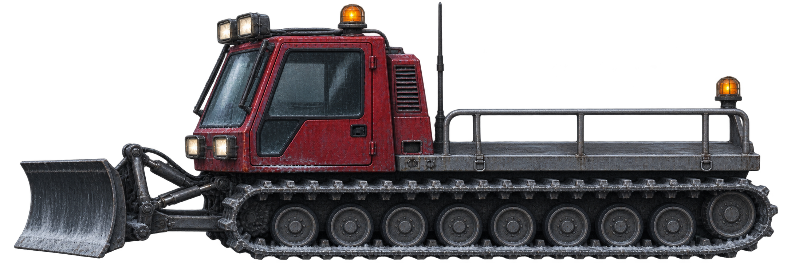

**État : pixels intégrés au jeu  fidélité à compléter** — 2172×724 pixels  1 963 290 octets.

Cabine rouge corrigée d’après le plan de soute ; plateau gris, lame attachée et chenilles lisibles. Géométrie frontale, marquages et nombre de galets ne sont pas certifiés. La silhouette alpha128 ne touche pas le bord, mais les marges haute/basse sont petites. Intégré comme décor existant ; aucune conduite ajoutée. Échelle de scène adaptée, sans mesure du film.

Références : [clipcafe-snowcat-hold-27s.jpg](https://clip.cafe/videos/seven-seasons-on-the-ice-and-ive-never-seen-a-gun-save-someones-life.mp4), [imcdb-snowcat-film.jpg](https://www.imcdb.org/i100380.jpg).

## Station baleinière — côtes irrégulières

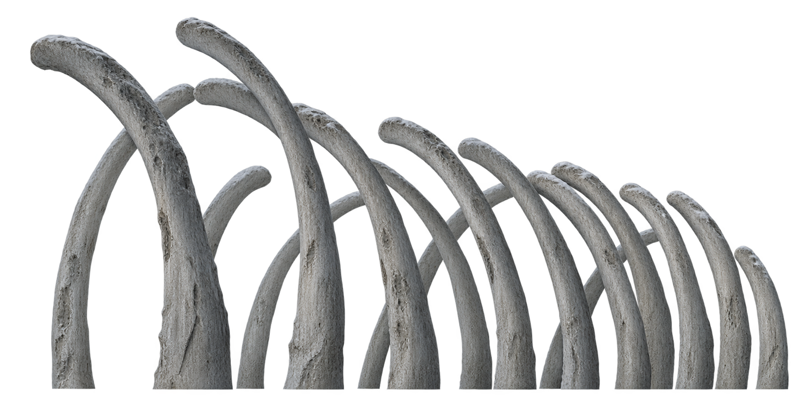

**État : pixels intégrés au jeu  fidélité à compléter** — 1774×887 pixels  1 763 267 octets.

Les côtes séparées, inégales et partiellement enfouies remplacent l’ancienne arche régulière avec colonne supérieure. La projection reste une adaptation à la scène. Nombre total, espacements et taille ne sont pas mesurés. Appui inférieur vérifié, passage vers le bureau dégagé ; occlusion des jambes de Lex cohérente avec le premier plan.

Références : [clipcafe-whalebones-film.jpg](https://clip.cafe/img800/what-are-these-whale-bones.jpg).

## Satellite Weyland — étude de la maquette

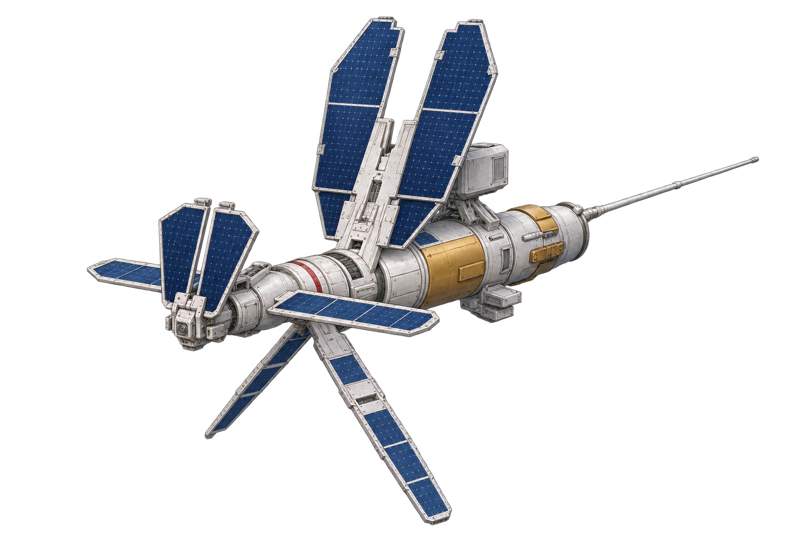

**État : candidat source uniquement** — 1536×1024 pixels  1 741 951 octets.

Corps axial allongé blanc/doré et plusieurs panneaux radiaux d’après la maquette John Lee, à la place du cube à deux ailes V001. Candidat source uniquement ; aucun satellite physique placé sur la passerelle. La photographie de 333×167 pixels ne valide ni le nombre exact de petits éléments, ni les faces cachées, ni la conformité au modèle final.

Références : [johnlee-satellite-maquette.jpg](https://www.johnleemodelmaker.me/images/avp/AVP_0018_S72.JPG).

## Celtic — costume endommagé masqué

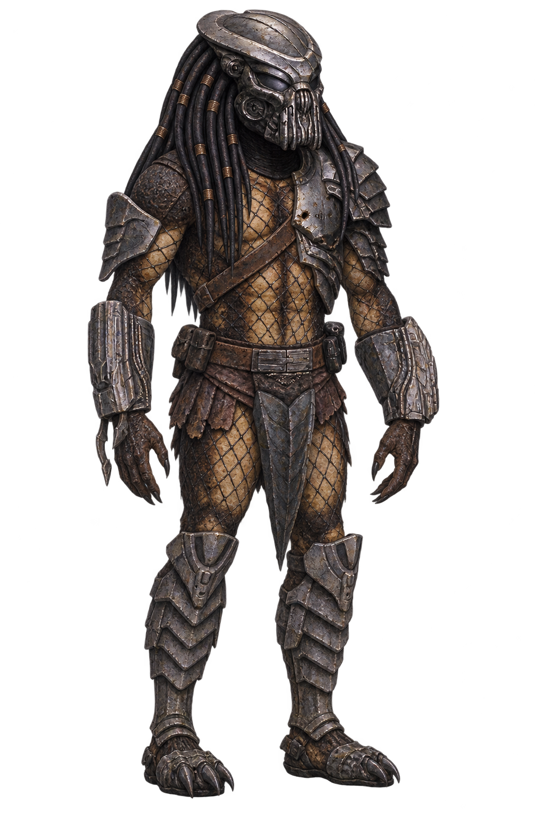

**État : candidat source uniquement** — 1024×1536 pixels  2 238 279 octets.

Masque, résille, peau marbrée, armure asymétrique, pagne et jambières reprennent la famille visuelle du costume exposé. Le résultat reste surtout de trois quarts frontal, malgré la demande de vue latérale ; pose non admise à la locomotion. Aucun canon d’épaule ajouté. Le costume endommagé n’est pas une variante intacte et l’usure de collection ne prouve pas l’état précis dans le film.

Références : [propstore-celtic-costume.jpg](https://propstoreauction.com/images/lot/7165/716572_xl.jpg?ts=1746206591).

## Reine — étude de machine de ponte

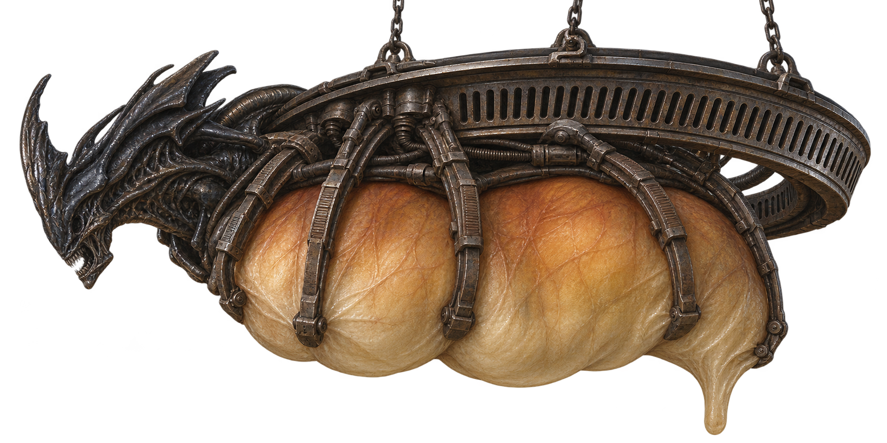

**État : candidat source uniquement** — 1774×887 pixels  2 211 150 octets.

Étude du grand arc nervuré, des brides et de la masse organique lobée, sans la caméra de tournage visible dans une référence. L’anatomie et les petits mécanismes sont reconstruits à partir de deux photos de 333×167. Les chaînes sont tronquées en haut du cadre : 64 pixels alpha≥128 touchent le bord. Candidat documentaire incomplet ; aucune admission runtime, aucun plafond ou ancrage fictif ajouté à la salle.

Références : [johnlee-queen-machine-side.jpg](https://www.johnleemodelmaker.me/images/avp/P1010084_S72.JPG), [johnlee-queen-hoist.jpg](https://www.johnleemodelmaker.me/images/avp/P1010017_S72.JPG).

## Comparaison dans le jeu — zone d’arrivée

Captures Chromium desktop 1365×900, même fixture de chapitre 2 et mouvement réduit. Le message « Carnet importé » rend explicite le point de départ de test. Les images sont des captures du vrai rendu, sans retouche.

### Avant

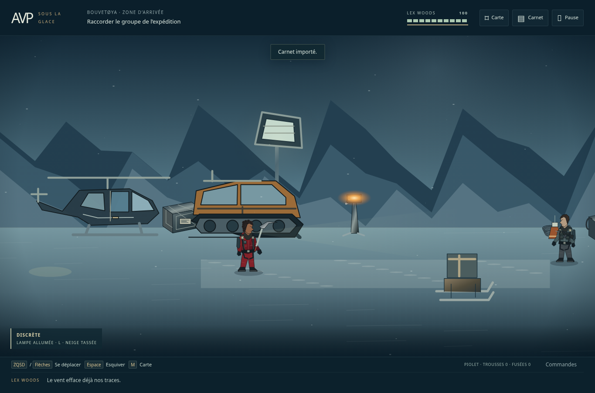

### Après

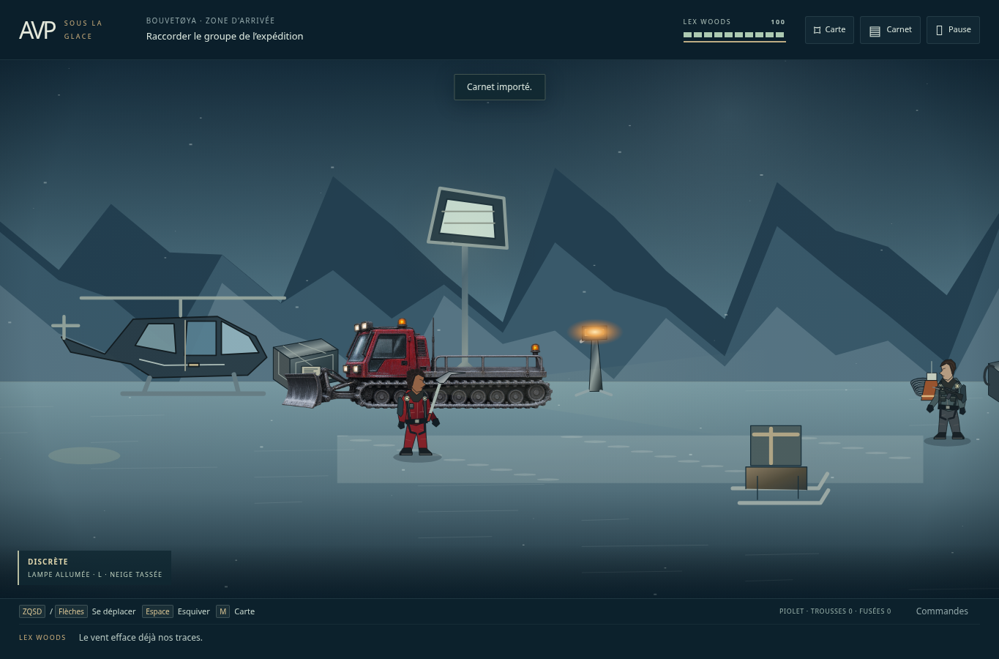

## Comparaison dans le jeu — station baleinière

### Avant

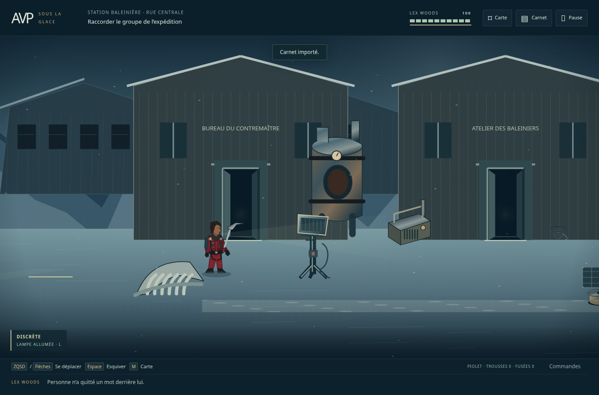

### Après

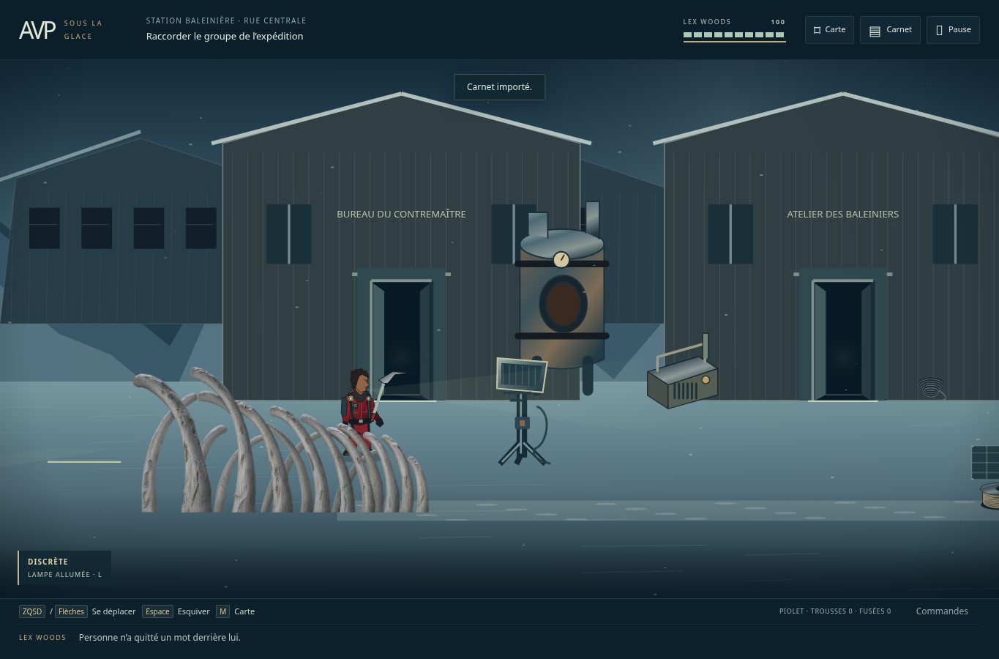

## Mobile — scènes et commandes existantes

Captures 390×844. Les commandes tactiles occupent encore une partie importante du bas de la scène. Les interactions et les retours ont été testés ; aucune refonte de leur disposition n’est revendiquée.

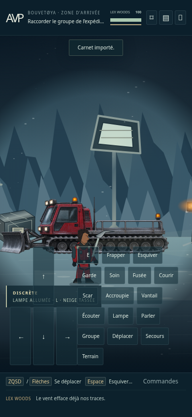

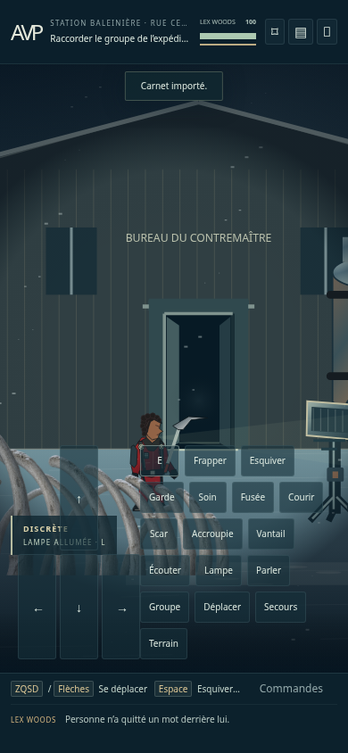

## Lecture des limites

La cabine rouge et les côtes irrégulières rapprochent deux décors de leurs références. Les personnages, les bâtiments et les fonds qui les entourent conservent le style SVG historique ; la scène entière n’est pas reproduite 1:1. Le cadrage technique alpha128 préserve le contact et le ratio des deux décors actifs. Il ne mesure pas la ressemblance au film.

Le Celtic présenté plus haut reste surtout frontal ; la machine Reine possède des extrémités de chaînes tronquées. Ces défauts sont conservés dans le suivi de production et empêchent leur admission au rendu dans cette passe.
